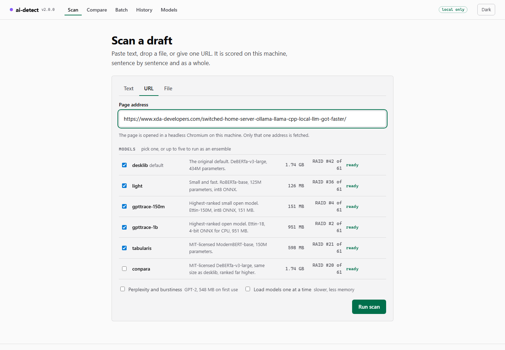
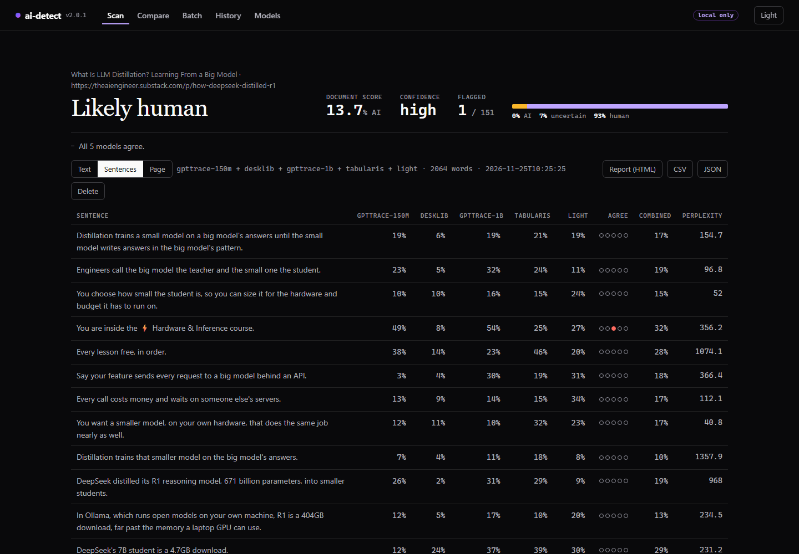
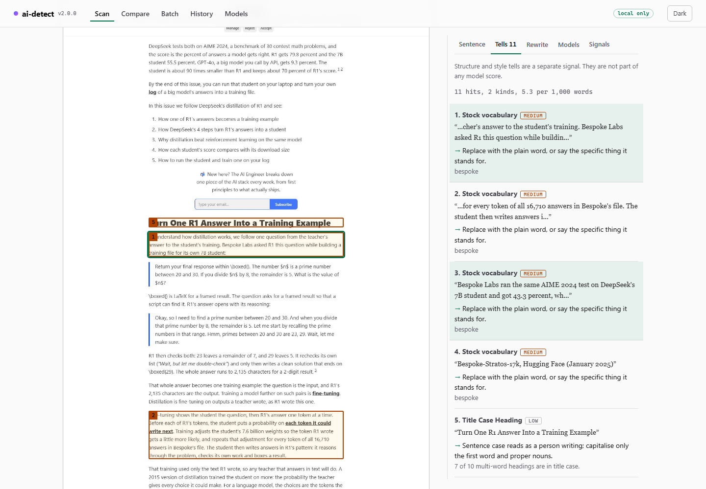
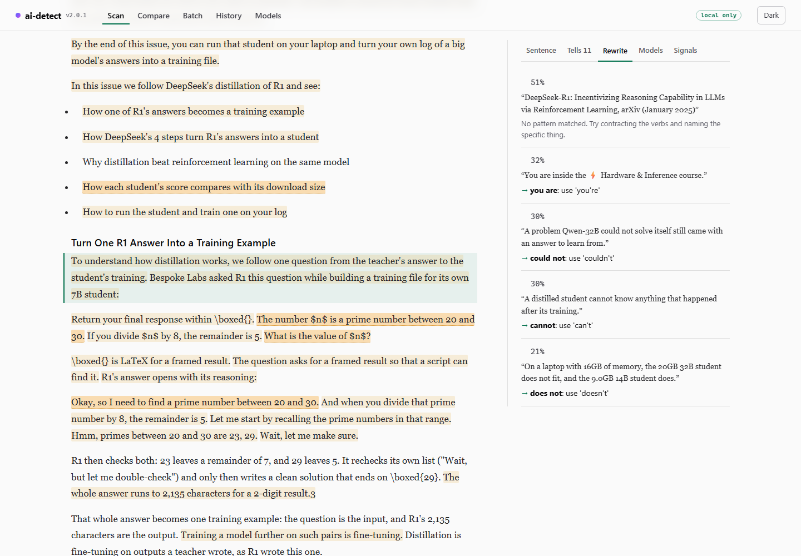
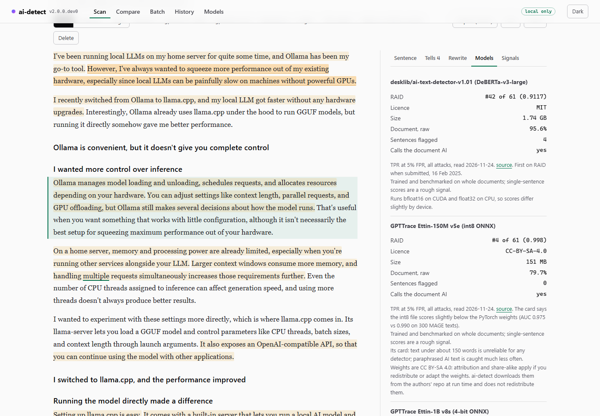
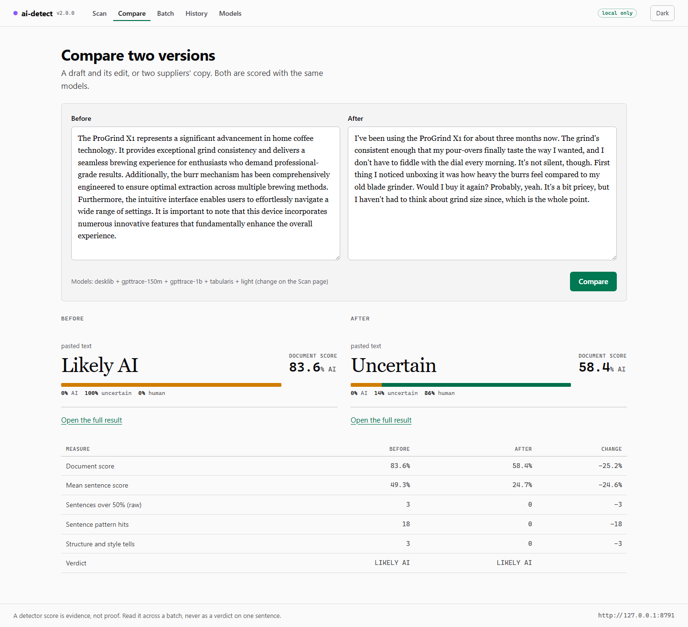
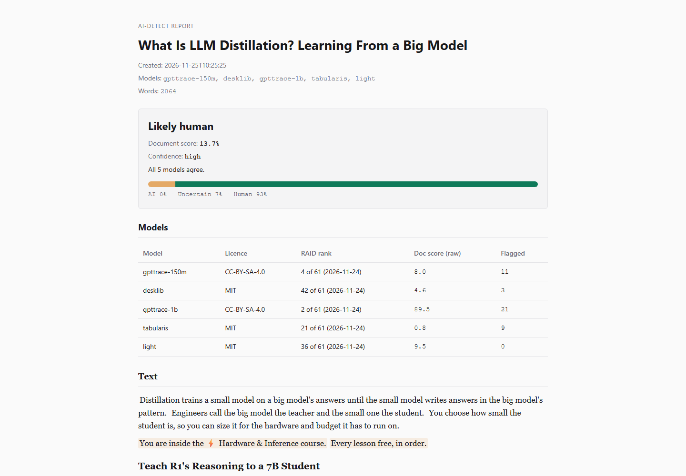

<div align="center">
  
</div>

# ai-detect - an AI text detector that runs on your own machine

I built ai-detect because I wanted to see, sentence by sentence, what AI detectors react to in my own published work. I didn't want to paste that work into somebody else's website to find out. So it runs open detector models locally, and the text you scan never leaves your machine.

You get a verdict for the whole document, a score for every sentence, plain reasons and rewrite suggestions for the flagged ones, and a separate list of page-level "structure and style" tells. There are three ways in: a command-line tool, an MCP server for Claude, and a web dashboard on 127.0.0.1. MIT licensed.


That's a five-model scan of one web page, made on 25 Nov 2026. It shows what the tool reported for that page on that day. It's a demonstration of the tool, and it isn't a finding about the article or whoever wrote it.

## The one thing to know

Every model here is strong on passages and weak on single sentences.

In my evaluation the best model caught every AI passage at a 5% false-positive rate, and 42% of AI sentences. The default model caught 90% of passages and 29% of sentences. So the document score is the number to quote. The per-sentence shading is a rough signal, and I'd treat a flagged sentence as a prompt to read the line again.

Scores are evidence, not proof. The measurements are in [Models](#models) and in [`docs/MODEL-EVAL-2026-11.md`](docs/MODEL-EVAL-2026-11.md).


Whatever you give it is parsed into headings, paragraphs and lists, split into sentences, and packed into passages of about 200 words. Four signals come out: the model scores, the sentence patterns, the structure and style tells, and (if you ask) perplexity. The model score never includes the other three. They explain it and cross-check it. There's more in [`docs/HOW-IT-WORKS.md`](docs/HOW-IT-WORKS.md).

## Contents

- [Install](#install)
- [URL scanning: the extra and the browser](#url-scanning-the-extra-and-the-browser)
- [First run and the model download](#first-run-and-the-model-download)
- [The dashboard](#the-dashboard)
- [The command line](#the-command-line)
- [The MCP server](#the-mcp-server)
- [Models](#models)
- [Ensembles](#ensembles)
- [Sentence patterns](#sentence-patterns)
- [Structure and style tells](#structure-and-style-tells)
- [Visual tells](#visual-tells)
- [Perplexity and burstiness](#perplexity-and-burstiness)
- [Scanning a URL](#scanning-a-url)
- [History, export and batch](#history-export-and-batch)
- [GPU routes](#gpu-routes)
- [Privacy](#privacy)
- [Limits and known gaps](#limits-and-known-gaps)
- [Environment variables](#environment-variables)
- [Development](#development)
- [Licence](#licence)

## Install

There are three routes. Pick one.

### With npx

Besides npx itself you need `uv` on your PATH, and nothing else. `uv` supplies Python and installs the dependencies into its own cache.

```bash
npx -y --package @houtini/ai-detect ai-detect draft.md
```

The first start takes about a minute while `uv` installs PyTorch. After that it's a couple of seconds. Without `uv` the launcher prints install instructions and exits.

For Claude Desktop, this goes in `claude_desktop_config.json`:

```json
{
  "mcpServers": {
    "ai-detect": {
      "command": "npx",
      "args": ["-y", "--package", "@houtini/ai-detect", "ai-detect-mcp"]
    }
  }
}
```

This route was checked from a locally packed copy of the package, on Windows and in a clean Linux container: the install, an MCP handshake and a scan.

### Clone and pip on Windows

You need Python 3.11 or later and git. In PowerShell:

```powershell
git clone https://github.com/houtini-ai/ai-detect
cd ai-detect
python -m venv .venv
.\.venv\Scripts\Activate.ps1
pip install .
ai-detect --version
```

That prints `ai-detect 2.0.0`. The install takes a bit over a minute and the virtual environment comes to 938 MB. It works from a user folder with a space in its name.

### Clone and pip on Linux

Stock Debian and Ubuntu refuse a system-wide `pip install` (`error: externally-managed-environment`), so the virtual environment isn't optional here.

```bash
sudo apt-get install -y python3 python3-venv python3-pip git ca-certificates
git clone https://github.com/houtini-ai/ai-detect
cd ai-detect
python3 -m venv .venv
. .venv/bin/activate
pip install . --extra-index-url https://download.pytorch.org/whl/cpu
ai-detect --version
```

The `--extra-index-url` part gets you CPU-only PyTorch, and that's the option I'd take unless you have an NVIDIA card and want it for the PyTorch models. Without it, pip pulls the CUDA build of PyTorch and about 3 GB of NVIDIA libraries whether or not the machine has a GPU. The virtual environment is 5.7 GB that way, against about 1.4 GB CPU-only.

Use the one-command form shown. The usual two-step form (`pip install torch --index-url ...` first) fails with the older pip that Debian 12 ships.

This was run on Debian 12 (Python 3.11) and Ubuntu 24.04 (Python 3.12).

### macOS

I haven't run ai-detect on a Mac. On Apple silicon the wheels it needs exist (they need macOS 14 or later), so a virtual environment and `pip install .` should resolve. That's untried. On an Intel Mac there's no PyTorch wheel new enough, so it can't be installed. Neither model family uses the Apple GPU.

### What the install gives you

Two commands: `ai-detect` (the CLI and the dashboard) and `ai-detect-mcp` (the MCP server). A plain `pip install .` runs five of the six models, the default included.

| Extra | Adds | You need it for |
|---|---|---|
| `web` | playwright | URL input and `.html` files |
| `conpara` | sentencepiece, protobuf | The `conpara` model |
| `all` | `web` and `conpara` together | |
| `dev` | pytest | Running the tests |

`light` and `onnx` are still accepted and add nothing, so `pip install ".[light]"` from older instructions doesn't break. `gpu-directml` is kept as a name and installs nothing. See [GPU routes](#gpu-routes).

## URL scanning: the extra and the browser

Scanning a URL or an `.html` file needs Playwright and its Chromium build. If they're missing, ai-detect prints the install commands and stops.

**Windows.** From the clone, with the virtual environment active:

```powershell
pip install ".[web]"
playwright install chromium
```

**Debian and Ubuntu.** The plain `playwright install chromium` isn't enough here. Playwright's own driver needs `libatomic1` before either of its install commands can run, and Chromium then needs system libraries that `--with-deps` installs. As root, or with sudo:

```bash
pip install ".[web]"
apt-get install -y libatomic1
playwright install --with-deps chromium
```

All three steps were needed on `debian:12`, `debian:12-slim` and `ubuntu:24.04` images. The transcript is in [`docs/proofs/linux-venv-2026-11-25.md`](docs/proofs/linux-venv-2026-11-25.md). A desktop Linux install that already has a browser's libraries wasn't tried. Chromium is about 700 MB on disk.

**npx.** Set `AI_DETECT_EXTRAS=web` and the launcher adds the Playwright package. Chromium still has to be installed, so for URL scanning I'd use a clone install.

The Windows browser step wasn't re-run on a clean machine for this release, and macOS wasn't run at all.

## First run and the model download

Scan a file:

```bash
ai-detect draft.md
```

The models aren't in the repo. The first scan downloads the default model, `gpttrace-150m`, from its authors' Hugging Face repository. That's about 151 MB, once. On my machine the first scan took about half a minute including the download, and a second after that.

You'll see a warning from huggingface_hub about unauthenticated requests on every run, and on Windows a one-off warning about symlinks. Neither stops anything.

| What downloads | Size | When |
|---|---|---|
| `gpttrace-150m` (the default) | 151 MB | First scan |
| `light` | 126 MB | First scan with `--model light` |
| `tabularis` | 598 MB | First scan with `--model tabularis` |
| `gpttrace-1b` | 951 MB | First scan with `--model gpttrace-1b` |
| `desklib` | 1736 MB | First scan with `--model desklib` |
| `conpara` | 1738 MB | First scan with `--model conpara` (plus a tokenizer and config from microsoft/deberta-v3-large, under 5 MB) |
| GPT-2, for the perplexity readout | 548 MB | First use of `--perplexity` |

To fetch weights ahead of time:

```bash
ai-detect download gpttrace-1b
ai-detect download light,desklib
ai-detect download all
```

A download resumes if it's interrupted. A failed one stays failed until you ask for it again: `ai-detect download <model>`, Retry on the dashboard's Models page, or `prefetch` over MCP. `HF_HOME` and `HF_HUB_CACHE`, the standard Hugging Face variables, move the model cache.

## The dashboard

```bash
ai-detect serve
```

That opens your browser at `http://127.0.0.1:8765`, or the next free port if that one is busy. `--port N` picks the port and `--no-browser` stops it opening a browser. The dashboard also starts by itself the first time an MCP tool runs.

It listens on 127.0.0.1 only. Requests with any other Host header get a 403 and cross-site writes are refused. It makes no external requests and loads no web fonts. There are light and dark themes (your choice is remembered), keyboard access to every control, and a layout that stacks under 980 px.

The screenshots below are from scans made on 25 Nov 2026, on CPU. Most show one Substack article. They show what the tool reported for that page that day, and nothing more than that.

### Scan



Paste text, drop a `.txt`, `.md` or `.html` file on the box, type a URL, or pick a file. Tick one model or up to five. A sixth tick is refused. The two options are perplexity, and loading models one at a time. While a scan runs you see a download bar for any model that isn't on disk yet, then loading and scoring progress for each model.

### Result


The verdict comes first: the label, the calibrated document score, the confidence, how many sentences were flagged, and a bar of words reading as AI, uncertain or human. Notes sit underneath.


- **Document score** is the calibrated score of the passages. It's the number to quote. Over 60 reads "Likely AI", under 40 "Likely human", and anything between is "Uncertain".
- **Confidence** drops to low when the text is under about 150 words, when the score is near 50%, or when the models disagree.
- **Raw and calibrated.** A model's raw percentage is what it printed. Its calibrated value is that same score re-read so that 50% means "about 5% of human text scores this high". The two can differ a great deal. In the screenshot above, the selected sentence is 19% calibrated and 65% raw.

There are three views of the document:

| View | Shows |
|---|---|
| **Text** | Sentences shaded amber to red by calibrated score, with an underline that changes by band. Pattern matches are underlined |
| **Sentences** | A table with one column per model, agreement dots and the combined score |
| **Page** | URL scans only: the screenshot with tells outlined and numbered |





And five tabs in the side panel:

| Tab | Shows |
|---|---|
| **Sentence** | Each model's score for the selected sentence, why it was flagged, rewrite suggestions |
| **Tells** | The structure and style tells. Click one to highlight its blocks or its region |
| **Rewrite** | Every flagged sentence with its suggestions |
| **Models** | Each model's facts and its view of the document |
| **Signals** | Sentence-length variation, perplexity and burstiness, the passages, and the optional vision second opinion |







From a result you can export an HTML report, a CSV or JSON, and delete the scan.

### Compare



Two boxes, each taking text or one URL. It's meant for a draft against an edit. You get both verdicts side by side and a table with before, after and change for each row:

- the verdict, the calibrated document score, and the sentences flagged at the operating point
- for a single model, three rows labelled raw: the document score, the mean sentence score, and sentences over 50%. For an ensemble, the mean sentence score
- sentence pattern hits, and structure and style tells

### Batch

One URL or file path per line, several dropped files, or both. Rows appear as they finish and a failed item shows its error. There's a CSV summary download.

### History


Every scan made through the dashboard or the MCP server, newest first. Click one to reopen it. The Document column is the calibrated document score, the same figure and verdict as the result page. The Sentences column is a raw mean when one model ran, and it's marked `raw`. A switch turns saving to disk off, and Clear history deletes everything.

Command-line scans aren't saved. See [History, export and batch](#history-export-and-batch).

### Models


Size, licence, RAID rank with a source link and the date it was read, caveats from the model cards, and Download or Retry with a live progress bar.

## The command line

| Command | Does |
|---|---|
| `ai-detect [input] [flags]` | Scan one input and print the report |
| `ai-detect serve [--port N] [--no-browser]` | Run the dashboard on 127.0.0.1 (default port 8765, next free port if busy) and open the browser |
| `ai-detect download <id\|id,id\|all>` | Download model weights with a progress bar. Resumes if interrupted |
| `ai-detect models [--json]` | List models, size, licence, RAID rank, download state |

| Flag | Short | Meaning |
|---|---|---|
| `--file PATH` | `-f` | A text, Markdown or HTML file. `.html` and `.htm` are rendered with Chromium (needs `[web]`) |
| `--text STRING` | `-t` | Text given on the command line |
| `--url URL` | `-u` | Fetch one page and scan it (needs `[web]`) |
| positional | | A file path, a URL, or text. A value that looks like a path but does not exist is an error |
| (none) | | Reads standard input |
| `--compare A B` | `-c` | Scan two files or URLs and print both reports and the change |
| `--batch LIST` | `-b` | A text file with one path or URL per line (`#` comments allowed). Prints a summary table |
| `--model ID[,ID...]` | `-m` | One model, or up to five comma-separated as an ensemble. Default `gpttrace-150m` |
| `--ensemble` | `-e` | Every downloaded model, up to five |
| `--device auto\|cpu\|cuda` | `-d` | Default `auto`: a GPU if one is usable, else CPU. [GPU routes](#gpu-routes) says when one is |
| `--perplexity` | `-p` | Add the GPT-2 perplexity and burstiness readout (548 MB on first use) |
| `--no-tells` | | Skip structure and style tells |
| `--low-memory` | | With an ensemble, load and unload models one at a time |
| `--timeout SECONDS` | | URL fetch timeout, default 30 |
| `--export PATH` | `-o` | Also write the report: `.html`, `.csv` or `.json` (with `--batch`: a `.csv` or `.json` summary) |
| `--json` | `-j` | Print the full report as JSON |
| `--version` | `-V` | Print the version |

The command line doesn't save scans. Nothing is written unless `--export` names a file.

### Examples

A bare scan with the default model, on a 72-word test file. This is real output, with the download lines and the tells section left off:

```
$ ai-detect sample.txt
  Model AI score (raw mean of sentences): 63.4% - LIKELY AI   [gpttrace-150m]
  Assessment: Uncertain (calibrated document score 54.1%, confidence low)
  Sentences: 2 AI / 2 Human / 4 scored
  SDSL: mean=18.0 words, stddev=4.9, CV=0.27 (very uniform (AI-like))
  Patterns: 3 formal verb, 3 ai slop, 2 formal transition, 1 vague abstraction
  Document score (raw): 82.9% over 1 passage(s), 72 words, confidence low
  At the 5%-false-positive operating point: 2 of 4 sentences flagged, document 54.1%
  Note: Only 72 words. The model cards call results under about 150 words unreliable.
  Note: Sentence scores are split, which can mean mixed authorship or an edited draft. Single-sentence scores are a rough signal.

  >> AI  (1.00) Furthermore, the platform provides a seamless experience for modern teams, and it offers comprehensive supp...
              ^ formal_verb: 'provides': try 'gives you' or 'has'
              ^ formal_verb: 'offers': try 'has' or 'comes with'
              ^ formal_transition: 'Furthermore': cut it, or use 'And' / 'On top of that'
              ^ ai_slop: 'seamless': replace with plain English
              ^ vague_abstraction: 'multiple': say how many, or name them
  >> AI  (0.99) Additionally, the solution leverages robust infrastructure to deliver scalable outcomes for every stakeholder.
              ^ formal_verb: 'deliver': try 'gives you' or just describe what it does
              ^ formal_transition: 'Additionally': cut it, or use 'And' / 'Plus'
              ^ ai_slop: 'leverages': replace with plain English
              ^ ai_slop: 'robust': replace with plain English
     HUM (0.90) I do not love the price, though, and my brother thinks it is too slow.
     HUM (0.55) We went back to the old one after about a week, mostly because the export kept failing on his laptop and no...
```

Read the second line, not the first. The first line keeps the 1.0.0 wording and is read from the raw sentence mean, so it can say "LIKELY AI" while the `Assessment:` line says "Uncertain". The assessment is the calibrated verdict, and it's the one the dashboard shows.

Two models as an ensemble. The figure in round brackets is the combined score, and `[2/2]` is how many models flag the sentence at their own thresholds:

```
$ ai-detect --model light,gpttrace-150m --text "Furthermore, the platform provides a seamless experience for modern teams. I don't love the price, though, and my brother agrees."
  Model AI score: 39.4% - LIKELY HUMAN   [ensemble]
  Assessment: Likely human (calibrated document score 29.7%, confidence low)
  Sentences: 1 AI / 1 Human / 2 scored
  SDSL: mean=10.0 words, stddev=0.0, CV=0.0 (very uniform (AI-like))
  Patterns: 1 formal verb, 1 formal transition, 1 ai slop
  Document score: 29.7% over 1 passage(s), 20 words, confidence low
  At the 5%-false-positive operating point: 1 of 2 sentences flagged, document 29.7%
  Note: Only 20 words. The model cards call results under about 150 words unreliable.
  Note: All 2 models agree.
  Per model (raw):
    light          sentences  96.4%  document  97.9%  flagged 1
    gpttrace-150m  sentences  70.6%  document  16.1%  flagged 1

  >> AI  (0.53) [2/2] Furthermore, the platform provides a seamless experience for modern teams.
              ^ formal_verb: 'provides': try 'gives you' or 'has'
              ^ formal_transition: 'Furthermore': cut it, or use 'And' / 'On top of that'
              ^ ai_slop: 'seamless': replace with plain English
     HUM (0.74) [0/2] I don't love the price, though, and my brother agrees.
```

Look at the two raw document scores: 97.9% from one model and 16.1% from the other, on the same 20 words. I wouldn't quote a result on text this short.

A batch with one bad path in the list, and a CSV summary:

```
$ ai-detect --model light --batch tests/fixtures/batch-list.txt --export eval_cache/batch-summary.csv
  document = calibrated document score; sentences = mean sentence score (raw when one model ran)
   document  sentences  flagged  tells  verdict        source
      55.3%      98.6%        5      3  Uncertain      examples/ai-sample.txt
      44.3%      83.8%        1      0  Uncertain      examples/human-sample.txt
                                        ERROR          examples/missing-file.txt: No such file: examples/missing-file.txt

  [1/3] examples/ai-sample.txt: Uncertain, document 55.3%
  [2/3] examples/human-sample.txt: Uncertain, document 44.3%
  [3/3] examples/missing-file.txt: No such file: examples/missing-file.txt
Wrote eval_cache/batch-summary.csv
```

The two bundled examples are 76 and 77 words, which is why both come out Uncertain.

An error is one line and a non-zero exit code. A mistyped file name gives `File not found: draft.tx` (exit 1), and an unknown model lists the six ids (exit 2).

### The JSON report

`--json` prints the full report, which is also what the dashboard reads. The verdict is under `assessment`: `label`, `ai_pct` (the calibrated document score), `confidence`, `notes` and `breakdown`.

Some keys keep their 1.0.0 names and meanings so old scripts still work. With one model, `model_ai_pct`, `document_ai_pct` and each sentence's `ai_prob` and `label` are raw. With several models, `ai_prob` is the ensemble's calibrated mean. The full key list is in [`docs/FEATURES.md`](docs/FEATURES.md), section 3.

## The MCP server

The server is `ai-detect-mcp`, over stdio. Once it's configured you can ask Claude to check a draft by file path, and the engine reads the file, which means a long draft never has to enter the conversation.

### Configuration

For a virtual-environment install on Windows, give Claude Desktop the full path to the command. This goes in `claude_desktop_config.json`. Change the path to wherever you cloned the repo, and double every backslash, or the file isn't valid JSON:

```json
{
  "mcpServers": {
    "ai-detect": {
      "command": "C:\\Users\\<user>\\ai-detect\\.venv\\Scripts\\ai-detect-mcp.exe"
    }
  }
}
```

On Linux the command is `.venv/bin/ai-detect-mcp` inside the clone. Give its full path the same way.

If `ai-detect-mcp` is on your PATH, the short form works:

```json
{
  "mcpServers": {
    "ai-detect": { "command": "ai-detect-mcp" }
  }
}
```

Or through Python, here with an environment variable set:

```json
{
  "mcpServers": {
    "ai-detect": {
      "command": "python",
      "args": ["-m", "ai_detect.server"],
      "env": { "AI_DETECT_DEVICE": "cpu" }
    }
  }
}
```

The npx form is under [Install](#with-npx). For Claude Code:

```bash
claude mcp add ai-detect -- ai-detect-mcp
```

**What has and hasn't been tried.** None of these configs has been loaded into Claude Desktop or Claude Code. What was run is the full-path Windows command, started the way a client starts it: the command alone, no shell, virtual environment not activated. It completed the handshake, listed its 9 tools and ran a scan with the default model. The `python -m` form is the one the automated tests use. The repo also carries an MCPB `manifest.json` for a Claude Desktop bundle. A bundle was packed and its command run by hand, and it hasn't been installed into Claude Desktop.

### Tools

| Tool | What it does | Parameters (default) | May start a download |
|---|---|---|---|
| `detect_ai_text` | Scores text sentence by sentence and as a whole document | `text`, `model` (`"gpttrace-150m"`), `device` (`"auto"`), `include_all_sentences` (`false`), `perplexity` (`false`) | yes |
| `detect_ai_file` | Scores a local `.txt`, `.md` or `.html` file by absolute path. `.html` needs the `[web]` extra | `path`, `model` (`"gpttrace-150m"`), `device` (`"auto"`), `include_all_sentences` (`false`), `perplexity` (`false`) | yes |
| `detect_ai_url` | Fetches one web page and scores its article text. Also reports visual tells and saves a screenshot to the dashboard. Needs the `[web]` extra | `url`, `model` (`"gpttrace-150m"`), `device` (`"auto"`), `include_all_sentences` (`false`), `perplexity` (`false`), `timeout` (`30.0`) | yes |
| `compare_texts` | Analyses two texts, for example a draft and an edit, and reports both results and the change | `text_a`, `text_b`, `model` (`"gpttrace-150m"`), `device` (`"auto"`) | yes |
| `scan_batch` | Scans up to 200 file paths and URLs one after another and returns one summary row each | `items`, `model` (`"gpttrace-150m"`), `device` (`"auto"`) | yes |
| `list_models` | Lists every model: size, licence, RAID rank with its source and read date, runtime, download status | none | no |
| `get_model_status` | Says whether a model is ready, downloading, not downloaded or failed | `model` (`"gpttrace-150m"`) | no |
| `prefetch` | Starts downloading a model's weights in the background. `model` is an id, or `all` | `model` (`"gpttrace-150m"`) | yes (that is its job) |
| `open_dashboard` | Returns the address of the dashboard, starting it if needed. `open_browser=true` opens it | `open_browser` (`false`) | no |

`model` takes one id, or up to five comma-separated ids to run as an ensemble. All the tools are read-only except `prefetch` and `open_dashboard`.

A detect result carries the document score with its confidence under `assessment`, the flagged sentences with their patterns and rewrite suggestions, the structure and style tells, a `scan_id`, and `dashboard_url`, a local page with the highlighted text. The top-level `verdict` keeps the 1.0.0 words and is read from the raw sentence mean. The calibrated verdict is `assessment.label`. The full return shapes are in [`docs/FEATURES.md`](docs/FEATURES.md), section 4.

The server also sends instructions at initialize. They tell Claude that scores are evidence, not proof, to report the document score with its confidence and notes, and that single-sentence scores are a rough signal.

### While a model downloads

A detect, compare or batch call never waits for a download. If the model isn't on disk the download starts in the background and Claude gets this back at once:

```json
{
 "status": "downloading",
 "ready": false,
 "models": [
  "<one status object per model>"
 ],
 "dashboard_url": "http://127.0.0.1:8765/#/models",
 "message": "Downloading light (126.0 MB): 34%, about 1 min left. Watch progress at http://127.0.0.1:8765/#/models. Ask me again in a minute."
}
```

Claude relays the message, and asking again later returns the result. `get_model_status` gives the same progress for any model, and `prefetch` starts a download ahead of time. A failed download stays `failed`, with the reason in `error`, until it's asked for again.

### Two processes

The MCP server holds no models. Detection runs in a second process, the engine, which is the same local server `ai-detect serve` starts. The MCP server launches it, or reuses one already running on the default port if it's the same version. An engine it launched stops when the MCP server exits. I split them because the 1.0.0 server hung on every detect call on Windows. The split also lets the dashboard show what an MCP call is doing. The engine's log is `~/.ai-detect/engine.log`.

## Models

There are six. The default is `gpttrace-150m`.

| Id (aliases) | Model | Size | Licence of weights | RAID rank (score) | CPU speed | Needs |
|---|---|---|---|---|---|---|
| `gpttrace-150m` (`gpttrace`, `gpttrace-150`) **default** | [GPTTrace Ettin-150M v5e (int8 ONNX)](https://huggingface.co/nakas/gpttrace-ettin150-text-v5e) | 151 MB | CC-BY-SA-4.0 | 4 of 61 (0.9980) | 6.2 ms a sentence | core install |
| `gpttrace-1b` (`gpttrace-v8s`) | [GPTTrace Ettin-1B v8s (4-bit ONNX)](https://huggingface.co/nakas/gpttrace-v8s-1b) | 951 MB | CC-BY-SA-4.0 | 2 of 61 (0.9993) | 88.8 ms a sentence | core install |
| `desklib` | [desklib/ai-text-detector-v1.01 (DeBERTa-v3-large)](https://huggingface.co/desklib/ai-text-detector-v1.01) | 1736 MB | MIT | 42 of 61 (0.9117) | 49.8 ms a sentence | core install |
| `light` (`tmr`) | [TMR ai-text-detector (RoBERTa-base, int8 ONNX)](https://huggingface.co/onnx-community/tmr-ai-text-detector-ONNX) | 126 MB | MIT | 36 of 61 (0.9579) | 3.1 ms a sentence | core install |
| `tabularis` (`modernbert`) | [Tabularis ModernBERT R1.1](https://huggingface.co/tabularisai/ai-text-detection) | 598 MB | MIT | 21 of 61 (0.9898) | 13.4 ms a sentence | core install |
| `conpara` | [DeBERTa-ConPara (DeBERTa-v3-large)](https://huggingface.co/SES-Lab-OTH/deberta-conpara) | 1738 MB | MIT | 20 of 61 (0.9901) | 47.4 ms a sentence | `[conpara]` extra |

Select one with `--model <id>`.

The RAID rank is the leaderboard's default view (TPR at 5% FPR, all attacks), read on 24 Nov 2026 at https://raid-bench.xyz/leaderboard. It's a rank for whole documents. Two of the ranks are for a different file from the one ai-detect runs: `light` and `gpttrace-1b` are ranked on their full-precision weights and run here as quantised ONNX exports. The `gpttrace-150m` card says its int8 file scores slightly below the PyTorch weights. `desklib` was first on RAID when it was submitted in February 2025.

The speed column is from my own evaluation, on one Windows 11 machine, on CPU.

### What the evaluation found

On passages every model did well: AUROC was 0.955 to 0.999. AUROC is the chance that a random AI item outscores a random human one, so 0.5 is a coin toss. On single sentences it was 0.66 to 0.84.

There's a second problem with sentences. At the usual raw 0.5 cut-off, every model calls a large share of human sentences AI: from 39% (`conpara`) to 76% (`light`). The 1.0.0 tool labelled sentences at that cut-off. That's what the calibrated figure is for. Each model is re-read at the point where about 5% of human text is flagged, and the dashboard colours by that figure.

The corpus behind this is small: 25 human passages and 31 AI passages, and the AI half comes from one generator. The human text is formal or old, which is the kind of prose detectors over-flag. It compares the models with each other on one machine. It isn't a benchmark. RAID is. The full table and its limits are in [`docs/MODEL-EVAL-2026-11.md`](docs/MODEL-EVAL-2026-11.md).

### Strengths and weaknesses

| Model | Strengths | Weaknesses |
|---|---|---|
| `gpttrace-150m` | 6 ms a sentence, 151 MB, and the lowest share of human passages over 0.5 (8%) | Passage AUROC (0.969, 90% at 5% FPR) is below the four larger models, the reverse of what its RAID rank suggests. Still 63% of human sentences over 0.5 |
| `gpttrace-1b` | The best at both levels: sentence AUROC 0.840 and 42% at 5% FPR, passage AUROC 0.999 and 100% | The slowest on CPU: 89 ms a sentence, 0.9 s a passage. Its raw scores run hot. Its card names formal prose by non-native writers and commercial humanizer output as weak spots |
| `desklib` | Strong on passages (AUROC 0.996, 97% at 5% FPR). Loads with stock transformers and torch. MIT | The largest download bar one, with the second-slowest CPU speed. Flags 60% of human sentences at 0.5. Scores differ slightly by device (bfloat16 on CUDA, float32 on CPU) |
| `light` | The fastest and the smallest | The weakest at both levels (passage AUROC 0.955, 77% at 5% FPR). 76% of human sentences and 24% of human passages over 0.5 |
| `tabularis` | Passage AUROC 0.995 at 13 ms a sentence. MIT | The worst on paired sentences: it ranked the formal version above the casual one only 18 times in 24. The wrong model for pointing at lines to edit |
| `conpara` | Passage AUROC 0.999 and 100% at 5% FPR. The fewest human sentences over 0.5 (39%). MIT | 20% of human passages over 0.5. Its card reports false positives of 13% to 67% on academic prose. Needs `sentencepiece` and a compatible `protobuf` |

### Which to pick

| Situation | Pick | Why |
|---|---|---|
| First run, want a result in seconds | `gpttrace-150m` | 151 MB, 6 ms a sentence, 4th on RAID, fewest false positives on passages in the evaluation |
| Best single score on a document | `gpttrace-1b` | Best at both levels, 2nd on RAID. Allow about a second per 250 words on CPU |
| Must be MIT-licensed weights | `conpara` | 20th on RAID, passage AUROC 0.999. Accept the sentencepiece dependency |
| MIT and no extra dependency | `desklib` | Works with stock torch and transformers. Weaker rank and more false positives on sentences |
| Pointing at individual sentences to edit | `gpttrace-1b`, or `conpara` if MIT is required | Highest sentence AUROC. 3 of 24 casual sentences over 0.5 |
| Checking a result before acting on it | Ensemble: `gpttrace-1b,gpttrace-150m,conpara,desklib` | Shows disagreement. Does not raise accuracy |
| Many documents, low-power machine | `gpttrace-150m`, then re-check flagged ones with `gpttrace-1b` | Speed first, then the stronger model |
| Avoid | `tabularis` for sentence-level editing, `light` for anything you will report | Pair ranking 18 of 24. Weakest passage AUROC |

### Why the default is gpttrace-150m

The default was `desklib` until 25 Nov 2026. I changed it because of what a first run looks like. `gpttrace-150m` is a 151 MB download against 1.74 GB, and it scores a sentence in 6.2 ms against 49.8 ms on CPU. It's 4th of 61 on RAID against 42nd. In my evaluation 8% of human passages scored over 0.5 against 12%, and 3 of 24 casual sentences against 17.

It isn't better on every count. Its passage AUROC on my corpus is lower, 0.969 against 0.996.

`desklib` is unchanged and still supported: `--model desklib` on the command line, `"model": "desklib"` in an MCP call, or its tick box in the dashboard. Scores from the two models aren't comparable with each other, so a scan made with the old default and one made with the new will differ.

### The CC BY-SA 4.0 note

The `gpttrace-150m` and `gpttrace-1b` weights are CC BY-SA 4.0. The other four models are MIT. ai-detect downloads the weights from the authors' repository and doesn't redistribute them.

If you only run the model, the licence puts no condition on your text, on the results or on ai-detect's MIT code. Attribution and share-alike apply to someone who redistributes the weights or publishes a model adapted from them. If an all-MIT setup matters to you, `conpara` is the strongest MIT model here.

## Ensembles

Pass up to five models and they run side by side:

```bash
ai-detect --model gpttrace-1b,gpttrace-150m,conpara,desklib --file draft.md
ai-detect --ensemble --file draft.md        # every downloaded model, up to five
ai-detect --ensemble --low-memory --file draft.md
```

`--low-memory` loads and unloads the models one at a time. The dashboard has the same option on the Scan page.

The models' raw probabilities are on different scales, so averaging them averages the miscalibration. Each model gets its own operating point, and the ensemble score is the mean of the calibrated values. Agreement is the number of models over their own threshold. On held-out halves of my corpus, at the same 5% false-positive rate, the calibrated mean caught 41% of AI sentences against 33% for the mean of raw probabilities.

No combination beat the best single model on that corpus, though. The ensemble isn't an accuracy upgrade. What it gives you is the cross-check.

Here's what that looks like on the web page from the screenshots, a Substack article fetched on 25 Nov 2026. The scan was 2,064 words in 151 scored sentences and 17 passages.

| Run | Verdict shown | Calibrated document score | Confidence shown | Sentences flagged at the operating point |
|---|---|---|---|---|
| `gpttrace-150m` alone | Likely human | 6.3% | high | 11 of 151 |
| Five-model ensemble | Likely human | 13.7% | high ("All 5 models agree.") | 1 of 151 |

Both runs printed the same verdict. Underneath it, the raw figures don't agree with each other at all:

| Model (in the ensemble run) | Raw document score | Sentences over 0.5, raw | Sentences over its own threshold |
|---|---|---|---|
| `gpttrace-150m` | 8.0% | 93 | 11 |
| `desklib` | 4.6% | 74 | 3 |
| `gpttrace-1b` | 89.5% | 100 | 21 |
| `tabularis` | 0.8% | 100 | 9 |
| `light` | 9.5% | 109 | 0 |

The five raw document scores run from 0.8% to 89.5%, and every model put between 74 and 109 of the 151 sentences over its raw 0.5. Read at its own operating point, no model calls the document AI. `gpttrace-1b`'s raw 89.5% is below its passage threshold, because its raw scores run hot.

So a raw percentage from one detector isn't something to act on. That table is a demonstration of the tool and of how far the raw scores differ. It says nothing about the article or whoever wrote it.

## Sentence patterns

The pattern layer is rule-based. It explains a flagged sentence in plain terms and suggests a rewrite. No language model is called.

| Pattern | Catches |
|---|---|
| `missing_contraction` | "it is" where "it's" would do |
| `formal_verb` | 20 verbs, every inflection, -ise and -ize spellings |
| `formal_transition` | Openers such as "Furthermore" and "Additionally" |
| `ai_frame` | "For X who Y" |
| `ai_slop` | A list of 27 words |
| `vague_abstraction` | "multiple", "a wide range of", "numerous" |
| `flaggy_adverb` | "comprehensively", "fundamentally" |

Each finding has the matched text, a suggestion and character offsets. The report also carries a sentence-length metric (mean, standard deviation and coefficient of variation), which is the `SDSL` line in the CLI output.

[`docs/detection-patterns.md`](docs/detection-patterns.md) has a longer write-up from 1.0.0. Don't quote its percentages. They were measured with `desklib`, its headline pair didn't reproduce on 24 Nov 2026, and the page carries a notice saying so.

## Structure and style tells

These are page-level habits of machine-written copy. They're reported next to the model scores and never mixed into them. There are 24 checks, and each hit comes with its location, an example quoted from the text, a suggestion and a severity.

| Family | Tells |
|---|---|
| Prose | `em_dash`, `rule_of_three` (only when three-item lists are dense), `three_beat`, `not_x_but_y`, `stock_vocabulary`, `signpost_phrase`, `hedging_tail` (a trailing "-ing" clause), `hedge` |
| Sections | `stock_opener`, `definition_opener` (the first sentence defines the heading), `tidy_closer`, `conclusion_heading` |
| Headings | `emoji_heading`, `question_heading`, `title_case_heading`, `heading_density` |
| Lists | `bold_lead_bullets`, `emoji_bullets`, `lists_of_three`, `bold_lead_paragraphs`, `bullet_density` |
| Rhythm | `uniform_paragraphs`, `uniform_sentences` |
| FAQ | `faq_restates_body` |

At most 12 instances of one tell are listed, and the summary counts all of them. `--no-tells` skips them on the command line. On the worked example the list had 11: seven Title Case headings and four stock-vocabulary hits.

A hit proves nothing alone. People write em dashes and three-item lists. I'd read the list as an editing checklist.

## Visual tells

For URL and `.html` input only. These come from the rendered page's geometry and computed styles, and each one has a rectangle on the screenshot, which is what the Page view outlines.

`gradient_hero`, `centred_hero`, `card_grid_of_three`, `icon_feature_grid`, `uniform_section_rhythm`, `wall_of_bullets`, `icon_bullets`, `ai_image_candidate`, `stock_image_candidate`.

The two image tells are flagged only from a file name, alt text or caption, and they say so. Nothing analyses pixels. The worked example had no visual tells.

**Vision second opinion.** Optional and off by default. From the Signals tab, the screenshot can be sent to an OpenAI-compatible endpoint that you type in. A non-local address requires ticking a confirmation, because it uploads the screenshot. This hasn't been tried against a real vision model.

## Perplexity and burstiness

Add `--perplexity` on the command line, tick the option on the Scan page, or pass `perplexity=true` to an MCP detect tool.

GPT-2 ([openai-community/gpt2](https://huggingface.co/openai-community/gpt2), MIT, 548 MB on first use) scores each sentence. Perplexity is how predictable the words are to a small language model. Burstiness is how much that varies across the document. On the worked example the readout was a document perplexity of 238.0, a per-sentence mean of 352.6 and a burstiness of 320.9.

It's a readout with no verdict. It's there to look at beside the model score.

## Scanning a URL

```bash
ai-detect --url https://example.com/some-article/
```

You need the browser set up first: see [URL scanning: the extra and the browser](#url-scanning-the-extra-and-the-browser).

It fetches one page per call, through Playwright's Chromium, with JavaScript rendered. It follows that URL's own redirects and loads its sub-resources. It doesn't crawl, click, type, submit forms or sign in. Downloads are refused, dialogs are dismissed, and a page can't open a second window. The default timeout is 30 seconds (`--timeout`), and it's one deadline for the whole fetch.

The article is taken from `<article>` or `<main>`, or the container with the most paragraph text. Navigation, headers, footers, sidebars, cookie banners, author boxes and code blocks are dropped. It isn't perfect. On the worked example it kept a course banner near the top and, after the article, the footnotes and a few headings and related-post titles. A full-page JPEG is saved, clipped at 16,000 px.

### Public addresses only

A URL is refused, before a browser starts, when its host is or resolves to an address that isn't on the public internet.

| Refused | Examples |
|---|---|
| Loopback | `localhost`, `*.localhost`, `127.0.0.0/8`, `::1` |
| Private networks | `10.0.0.0/8`, `172.16.0.0/12`, `192.168.0.0/16`, `fc00::/7` |
| Link-local | `169.254.0.0/16` (cloud metadata services live here), `fe80::/10` |
| Carrier-grade NAT | `100.64.0.0/10` |
| Multicast, unspecified, reserved | `224.0.0.0/4`, `ff00::/8`, `0.0.0.0`, `::`, `240.0.0.0/4` |

The same rule runs inside the browser on every request the page makes, redirect hops included. Which means a public page can't redirect the fetch to your machine, your local network or a metadata service. It applies to the CLI, the dashboard and the MCP tools alike. The error names the address and the reason:

```
Refused to fetch http://localhost:8765/: localhost is a loopback address (this machine). ai-detect only fetches public internet addresses, so a page cannot be used to reach this machine or the local network. To scan a site on your own machine or LAN, set AI_DETECT_ALLOW_PRIVATE_URLS=1 in the environment ai-detect runs in and start it again.
```

`AI_DETECT_ALLOW_PRIVATE_URLS=1` is read from the environment of the process that does the fetching. For MCP that's the server's `env` block. No tool argument or dashboard control can set it.

The rule has limits. A DNS answer that changes between the check and the fetch (DNS rebinding) isn't caught, and WebSocket connections aren't inspected. The finer points are in [`docs/FEATURES.md`](docs/FEATURES.md), section 8.

## History, export and batch

**History.** Scans made through the dashboard or the MCP server are stored as JSON, plus a JPEG for URL scans, in `~/.ai-detect/history`. It keeps at most 200. `AI_DETECT_HISTORY=off`, or the switch on the History page, keeps scans in memory only, and `AI_DETECT_HOME` moves the folder.

Command-line scans aren't saved to history. To keep one, use `--export report.html` (or `.csv`, or `.json`), or `--json`.

**Export.** From a result page: an HTML report, CSV or JSON. The HTML report shows the calibrated document score, and for a single-model scan the raw one on its own labelled line.



**Batch.** Three ways in:

- `ai-detect --batch list.txt`, where the file has one path or URL per line and `#` starts a comment. `--export` writes a `.csv` or `.json` summary.
- The Batch page in the dashboard.
- The MCP tool `scan_batch`, which takes up to 200 file paths and URLs.

A failed item shows its error and the other rows still come back.

**Files.** Text, Markdown and HTML. File reads are capped at 20 MB. DOCX, PDF and images aren't supported.

## GPU routes

A plain install runs everything on the CPU, and for the default model that's quick enough that I wouldn't bother with a GPU. If you want one, the route depends on the model family. No model has been run on a GPU with ai-detect 2.0.0, so treat both routes as untested.

**The ONNX models** (`gpttrace-150m`, `gpttrace-1b`, `light`). The `onnxruntime` build that pip installs has no GPU provider. You swap it for a GPU build, inside the virtual environment:

```bash
pip uninstall -y onnxruntime
pip install --force-reinstall onnxruntime-directml   # Windows, DirectML
# or
pip install --force-reinstall onnxruntime-gpu        # NVIDIA CUDA
```

It has to be a swap. The GPU builds can't sit beside the CPU build: with both installed, the CPU one wins. That's why the old `gpu-directml` extra installs nothing now. After the swap, a later `pip install .` may put the CPU build back.

**The PyTorch models** (`desklib`, `tabularis`, `conpara`). These use CUDA when the installed PyTorch build has it and an NVIDIA GPU is present. On Windows, pip installs a CPU-only PyTorch even on a machine with NVIDIA cards, so you'd need a CUDA wheel from PyTorch's own index. On Linux, the default install (without the CPU-only option) already gets the CUDA build.

If you pass `--device cuda` and there's no GPU provider, ai-detect prints the swap commands and carries on with the CPU.

## Privacy

Text, files and fetched pages are never sent anywhere. Detection runs on your machine.

Three things do use the network:

1. **Model downloads** from Hugging Face, the first time you use each model.
2. **The one page** a URL scan is asked to fetch, with its redirects and sub-resources.
3. **A vision endpoint**, only if you turn the vision second opinion on and type in an address. That uploads the page screenshot to the address you gave.

The dashboard has no telemetry.

## Limits and known gaps

- **Scores are evidence, not proof.** There's no independent accuracy validation of ai-detect as a whole. It relies on each model's RAID result.
- **Calibration rests on a small corpus**: 25 human passages and one AI generator. The operating points are conservative for formal writing and unverified for other kinds.
- **English only.** No model here was tested on other languages.
- **Paraphrased and "humanized" text** wasn't tested.
- **A model's input is cut at 512 tokens, silently.** Passages are sized to fit.
- **No trained "mixed" class.** You get a word-share bar and an Uncertain band.
- **Rewrite suggestions are rule-based.** Whole rewritten sentences would need a language model, and none is called.
- **No DOCX, PDF or image input.** No plagiarism check, no writing history, no browser extension.
- **Platforms.** Run on Windows 11 and on Debian 12 and Ubuntu 24.04. Not run: macOS, any ARM machine, any GPU. There's no Windows ARM64 PyTorch wheel on PyPI.
- **A multi-GB model download through an MCP client** wasn't run. A 126 MB one was.
- **Download progress.** The first line of a progress bar can show a very large time estimate before any speed is known.

If you're coming from a hosted detector such as GPTZero, the trade is roughly this. You keep your text on your own machine, you can run several detectors side by side, and you get rewrite suggestions and the structure and visual tells. You give up a trained mixed-authorship class, paraphrase resistance, plagiarism checks, DOCX and PDF input, and published accuracy benchmarks for the product as a whole. [`docs/FEATURES.md`](docs/FEATURES.md) has the feature-by-feature table with its sources.

**Coming from 1.0.0?** Four things affect an existing install. The default model changed from `desklib` to `gpttrace-150m`. The Python floor rose from 3.9 to 3.11. The MCP server now runs detection in a second process. And `get_model_status` gained states it didn't have before. An install that used the `[gpu-directml]` extra also loses its GPU provider until you do the swap in [GPU routes](#gpu-routes). The CLI flags and the five original MCP tool names, parameters and result keys are unchanged. The rest is in [`CHANGELOG.md`](CHANGELOG.md).

## Environment variables

| Variable | Effect |
|---|---|
| `AI_DETECT_DEVICE` | `auto` (default), `cpu`, `cuda` |
| `AI_DETECT_PORT` | First dashboard port to try (default 8765) |
| `AI_DETECT_HOME` | Folder for history and the engine log (default `~/.ai-detect`) |
| `AI_DETECT_HISTORY` | `off` keeps scans in memory only |
| `AI_DETECT_READY_TIMEOUT` | Seconds the MCP server waits for its engine to start (default 60). After that the engine is stopped and the tool call fails with the log's path |
| `AI_DETECT_ALLOW_PRIVATE_URLS` | `1` lets URL scans reach loopback, private-network and other non-public addresses. Off by default |
| `AI_DETECT_EXTRAS` | npx launcher only: pip extras to install (default none; for example `web`) |
| `HF_HOME`, `HF_HUB_CACHE` | Standard Hugging Face variables. They move the model cache |

## Development

```bash
pip install ".[all]"
pip install ".[dev]"
python -m pytest --ignore=tests/ui     # 255 tests
python -m pytest tests/ui              # 44 browser tests
python scripts/release_check.py
```

- The 255 tests need no model and no network, except `tests/test_mcp_stdio.py`, which runs the real MCP server with the `light` model and is skipped if that model isn't downloaded.
- The 44 browser tests cover every dashboard control and error path, with a fake backend and a simulated download. They're skipped without Playwright.
- `scripts/release_check.py` checks versions, lint and tests, scans the branch history for secrets, checks the npm tarball, and runs an install-and-scan smoke test. The release steps are in [`docs/RELEASE.md`](docs/RELEASE.md).

Where things live:

| Path | What's in it |
|---|---|
| `ai_detect/models.py` | The model registry and the default |
| `ai_detect/patterns.py` | The sentence patterns |
| `ai_detect/tells.py` | The structure and style tells |
| `ai_detect/visual.py` | The visual tells |
| `ai_detect/normalize.py` | The GPTTrace input normaliser |
| `ai_detect/calibration.json` | The fitted operating points, for sentences and for passages |
| `ai_detect/server.py` | The MCP server |
| `ai_detect/web/app.py` | The engine and the dashboard's `/api/*` HTTP endpoints |
| `ai_detect/web/static/` | The dashboard: three static files, no build step |
| `bin/launch.js` | The npx launcher |
| `detect.py` | Keeps `python detect.py ...` working from the clone |

A few things only a maintainer needs:

- **Scripts.** `scripts/check_env.py` prints what is installed. `scripts/eval_models.py` and `scripts/calibrate_ensemble.py` produce the evaluation and the operating points. `scripts/make_screenshots.py` regenerates the screenshots. `scripts/build_features_doc.py` regenerates `docs/FEATURES.md` from `docs/features.template.md`, so re-run it after a code change. `scripts/smoke_mcp.mjs` starts an MCP command the way a client does and runs one scan.
- **Python API.** `from ai_detect import classify_text`, and `ai_detect.analyze.analyze`, `load_source` and `compare`.
- **MCP details.** It works with MCP Python SDK 1.x and 2.x, and the pin is `mcp>=1.10,<3`. `python -m ai_detect.server` starts the server too. While a scan runs the server sends progress notifications if the client supplied a `progressToken`. `ai-detect serve` has a hidden `--exit-with-parent` flag, which the MCP server uses.
- **Model quirks.** The two GPTTrace models put their input through a normaliser that strips invisible characters and Cyrillic and Greek look-alikes. `tabularis` applies NFKC normalisation. `conpara`'s checkpoint is a pickled state dict, and ai-detect loads it with `weights_only=True` and an allow-list of numpy array types.
- **A model with no fitted operating point** falls back to its raw scale and is listed under `uncalibrated_models` in the report.
- **Proofs.** The install transcripts are [`docs/proofs/windows-venv-2026-11-25.md`](docs/proofs/windows-venv-2026-11-25.md) and [`docs/proofs/linux-venv-2026-11-25.md`](docs/proofs/linux-venv-2026-11-25.md).

More reading: [`docs/FEATURES.md`](docs/FEATURES.md) (the full inventory, generated from real output), [`docs/MODEL-EVAL-2026-11.md`](docs/MODEL-EVAL-2026-11.md) (the measurements), [`docs/HOW-IT-WORKS.md`](docs/HOW-IT-WORKS.md) (the diagrams and the reasoning), [`CHANGELOG.md`](CHANGELOG.md).

## Licence

ai-detect is MIT licensed. See [`LICENSE`](LICENSE).

It doesn't contain or redistribute any model weights. When you select a model, its files are downloaded from the authors' own Hugging Face repository to your machine, and that model's licence applies to your use of it.

| Model | Licence of the weights |
|---|---|
| `desklib`, `light`, `tabularis`, `conpara`, GPT-2 (the perplexity readout) | MIT |
| `gpttrace-150m`, `gpttrace-1b` | CC BY-SA 4.0 |

The licences were read from each model card and the Hugging Face API on 24 Nov 2026. Check the card before commercial use, because a licence can change. The full table, and the note on the one vendored file (the ConPara input normaliser, MIT), is in [`THIRD-PARTY-MODELS.md`](THIRD-PARTY-MODELS.md). It's a plain-language summary, not legal advice.

Built by [Houtini](https://houtini.com).
