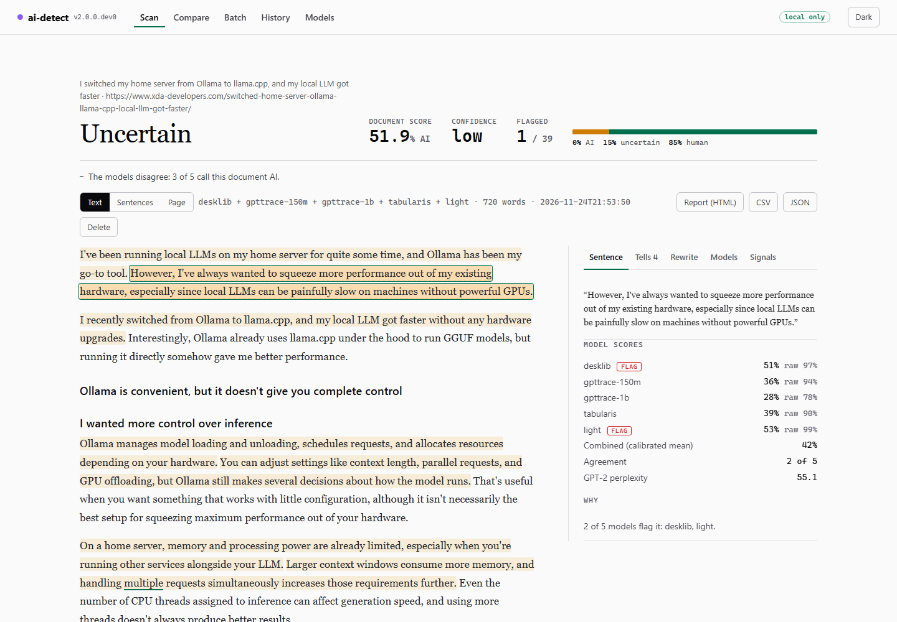
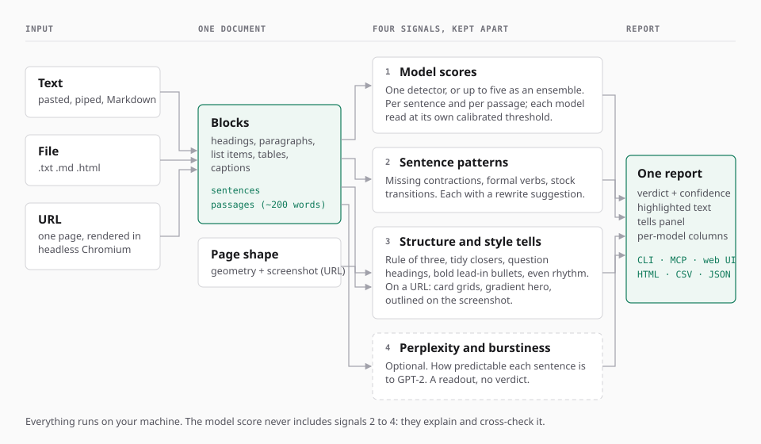
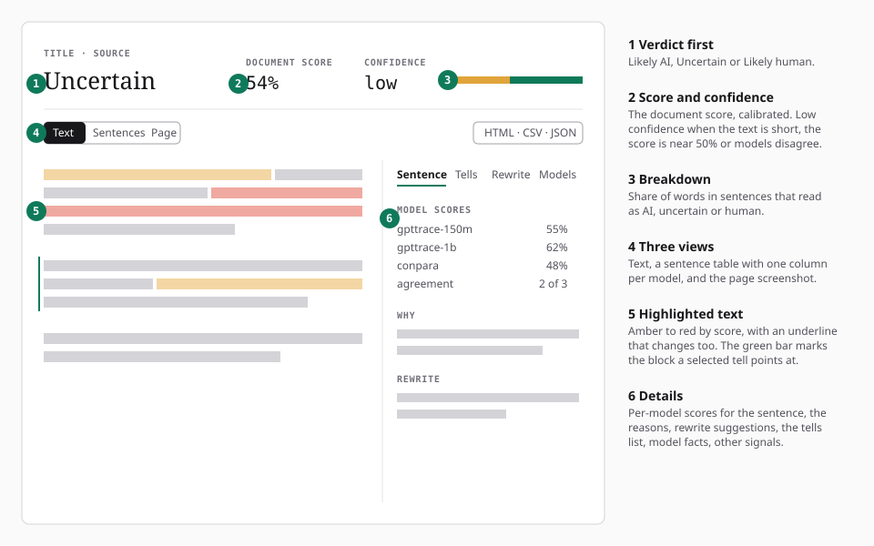
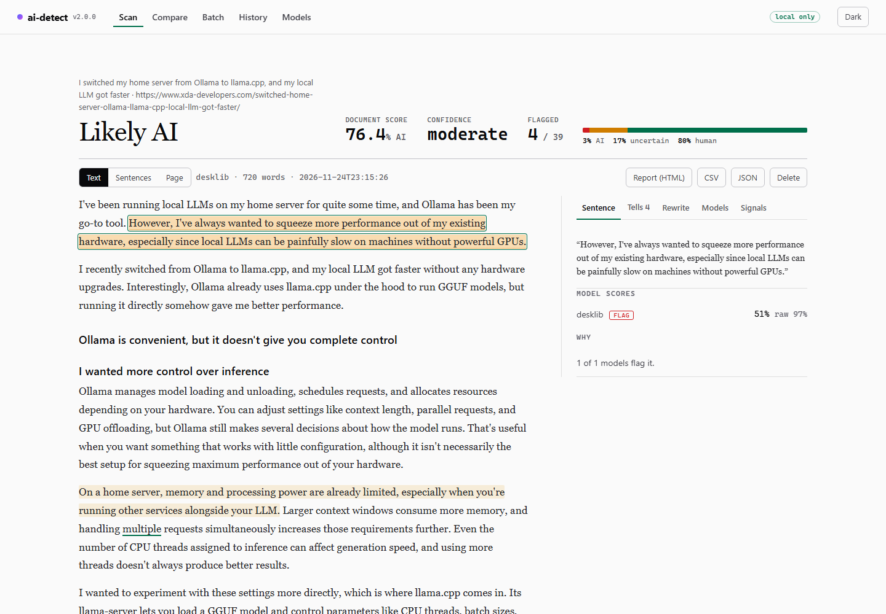
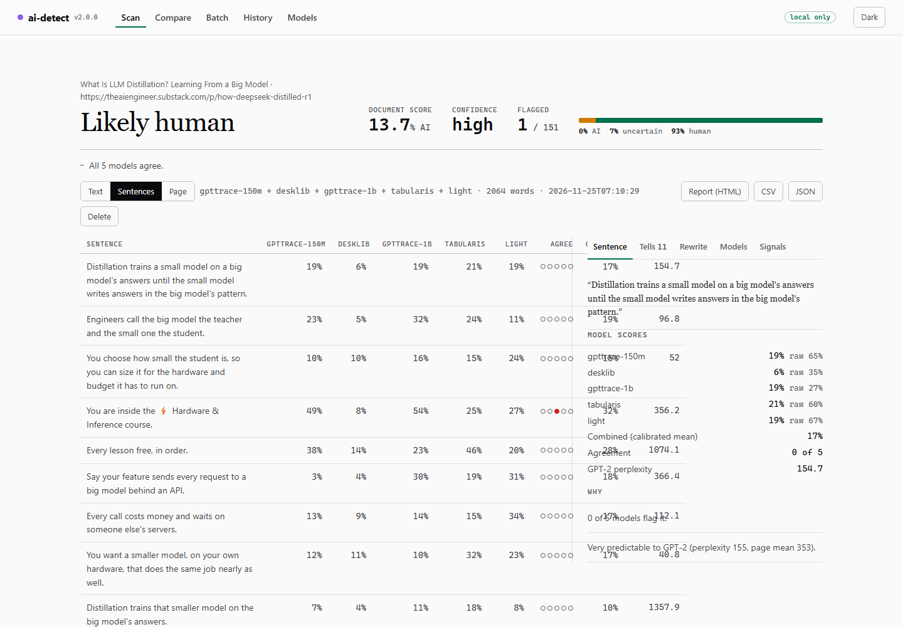
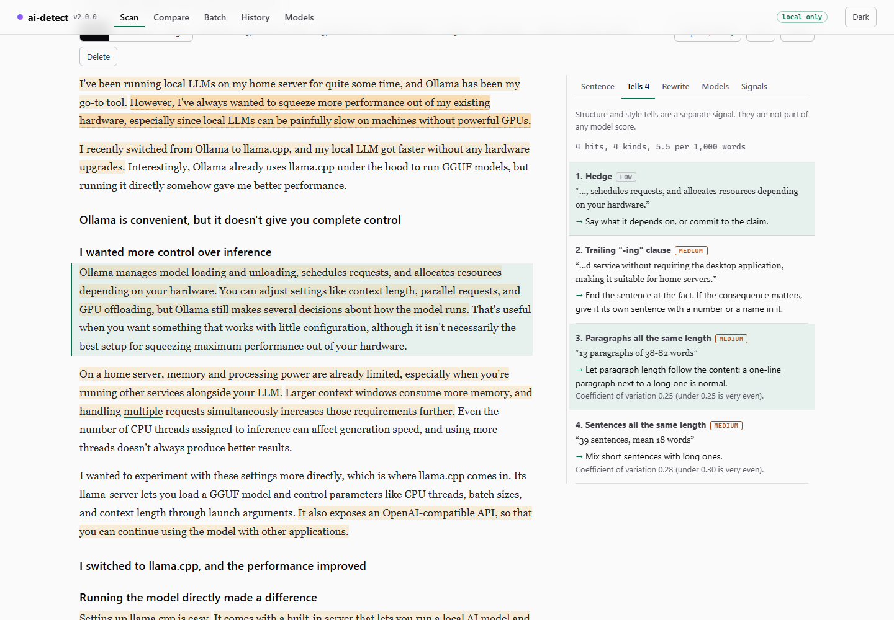
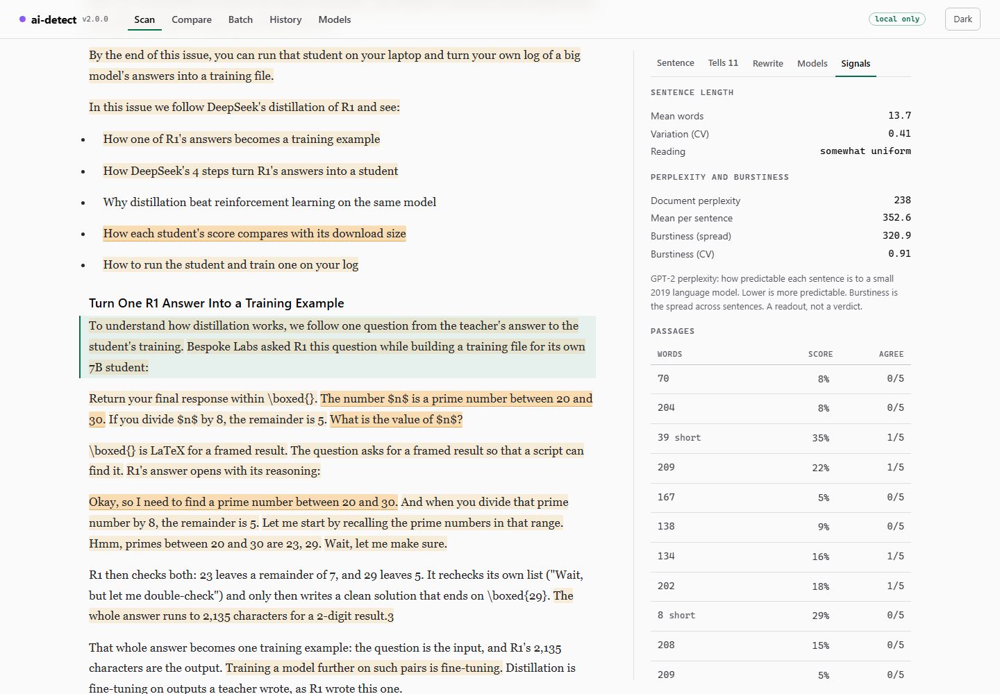
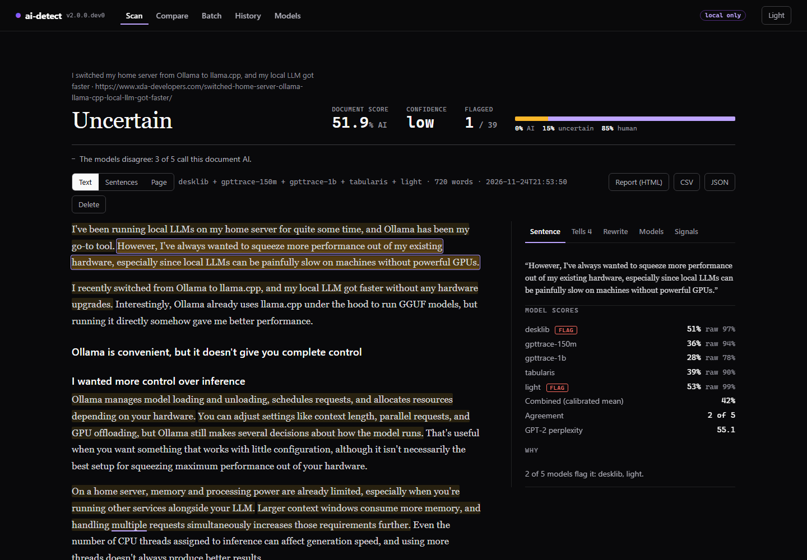
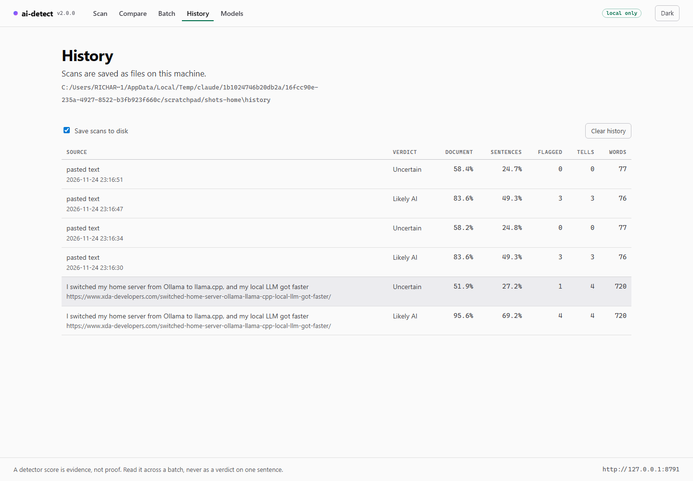
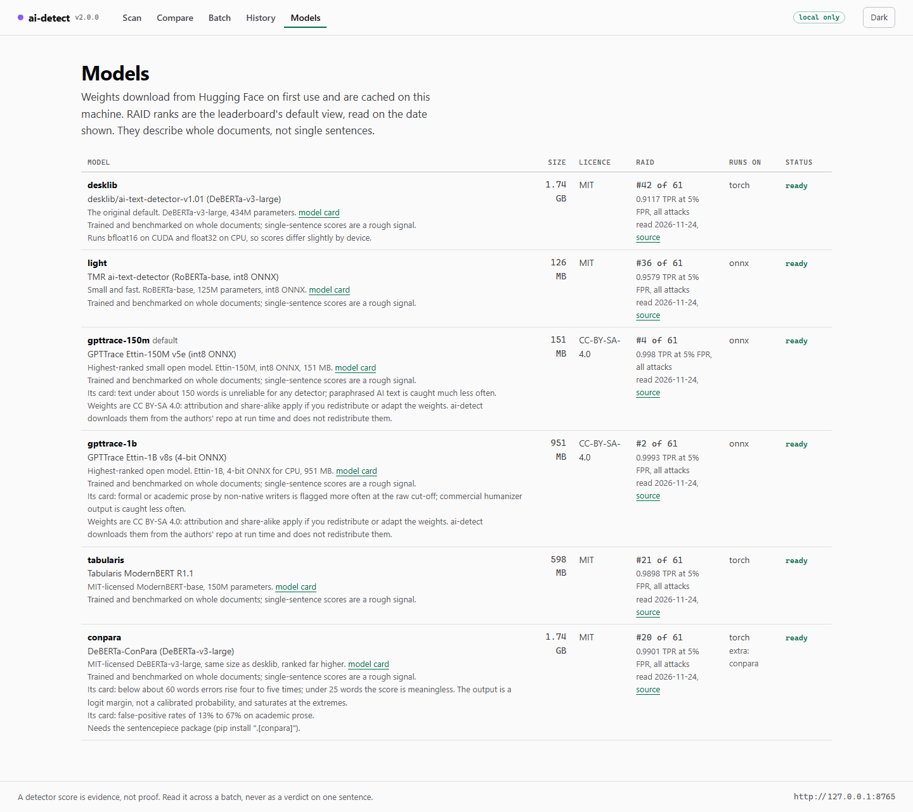

<div align="center">
  
</div>

# ai-detect - an AI text detector that runs on your own machine

I built ai-detect because I wanted to see, sentence by sentence, what AI detectors react to in my own published work. I didn't want to paste that work into somebody else's website to find out. So it runs open detector models locally, and the text you scan never leaves your machine.

It scores writing per sentence and per document, explains the flagged sentences with pattern findings and rewrite suggestions, and reports page-level "structure and style" tells as a separate signal. There are three front ends over one engine: a command-line tool, an MCP server, and a web dashboard served on 127.0.0.1. MIT licensed.



That's a five-model scan of one web page, made on 24 Nov 2026. It shows what the tool reported for that page on that day. It's a demonstration of the tool, and it isn't a finding about the article or whoever wrote it.

One thing to know before you start. Every model here is strong on passages and weak on single sentences. The document score is the number to quote. The per-sentence shading is a rough signal, and I'd treat a flagged sentence as a prompt to read the line again. The measurements are in [Models](#models) and in [`docs/MODEL-EVAL-2026-11.md`](docs/MODEL-EVAL-2026-11.md).

## Contents

- [How it works](#how-it-works)
- [Install](#install)
- [First run and model downloads](#first-run-and-model-downloads)
- [The dashboard](#the-dashboard)
- [The command line](#the-command-line)
- [The MCP server](#the-mcp-server)
- [Models](#models)
- [Ensembles](#ensembles)
- [Sentence patterns](#sentence-patterns)
- [Structure and style tells](#structure-and-style-tells)
- [Visual tells](#visual-tells)
- [Perplexity and burstiness](#perplexity-and-burstiness)
- [Scanning a URL](#scanning-a-url)
- [History, export and batch](#history-export-and-batch)
- [Privacy](#privacy)
- [Limits and known gaps](#limits-and-known-gaps)
- [Environment variables](#environment-variables)
- [Development](#development)
- [Licence](#licence)

## How it works



1. **Input.** Text, a file, or one URL. A URL is opened in headless Chromium on your machine, so the page is read the way a reader sees it.
2. **One document.** Whatever came in is parsed into blocks: headings, paragraphs, list items, tables, captions. Prose blocks are split into sentences. Consecutive sentences are also packed into passages of about 200 words, never across a heading.
3. **Four signals, kept apart.** Model scores, sentence patterns, structure and style tells, and (optionally) perplexity and burstiness.
4. **One report**, shown by the command line, the MCP server and the dashboard, and exportable.

The model score never includes the other three. They explain it and cross-check it.

The document score works on the passages. Each passage is scored whole, which is how the detectors were trained, and `document_ai_pct` is the word-weighted mean. Sentences under five words and all headings are skipped. Tables and code blocks are not scored.

There's more on the reasoning in [`docs/HOW-IT-WORKS.md`](docs/HOW-IT-WORKS.md).

## Install

ai-detect isn't on PyPI yet, so you install it from a clone. You need **Python 3.11 or later**. Current torch, transformers and onnxruntime need it.

```bash
git clone https://github.com/houtini-ai/ai-detect
cd ai-detect
pip install .                 # core: torch, transformers, mcp, starlette, uvicorn
pip install ".[light]"        # + onnxruntime: needed by light, gpttrace-150m, gpttrace-1b
pip install ".[web]"          # + playwright: URL input and .html files
playwright install chromium   # once, after the [web] extra
pip install ".[conpara]"      # + sentencepiece, protobuf: the conpara model
pip install ".[all]"          # everything above
```

If you want everything, `pip install ".[all]"` and then `playwright install chromium` is the short route.

| Extra | Adds | You need it for |
|---|---|---|
| (none) | torch, transformers, mcp, starlette, uvicorn | The `desklib` and `tabularis` models, the CLI, the MCP server, the dashboard |
| `light` (alias `onnx`) | onnxruntime | The `light`, `gpttrace-150m` and `gpttrace-1b` models |
| `web` | playwright | URL input and `.html` files. Run `playwright install chromium` once afterwards |
| `conpara` | sentencepiece, protobuf | The `conpara` model |
| `gpu-directml` | A DirectML GPU runtime | Optional. Not run in this work |
| `all` | Everything above | |
| `dev` | pytest | Running the tests |

The install puts two commands on your PATH: `ai-detect` (the CLI and the dashboard) and `ai-detect-mcp` (the MCP server). `python detect.py ...` still works from the clone. `python scripts/check_env.py` prints what is installed.

What was checked: the package builds and installs from source into a fresh environment through `uv` on Windows and in a clean `python:3.12-slim` Docker container, and the MCP server completes a handshake and a scan there. A plain `pip install .` into a new virtual environment was not run separately.

The repo also carries an MCPB `manifest.json` for a Claude Desktop bundle. A bundle was packed and its command run by hand. It hasn't been installed into Claude Desktop, and there's no hosted `.mcpb` file to download yet, so the clone is the route I'd use today.

## First run and model downloads

The detector models aren't in the repo. The first time you pick a model, its weights are downloaded from the authors' Hugging Face repository and cached in the Hugging Face cache. After that the model loads from disk.

| What downloads | Size | When |
|---|---|---|
| `desklib` (the default) | 1736 MB | First scan with the default model |
| `light` | 126 MB | First scan with `--model light` |
| `gpttrace-150m` | 151 MB | First scan with `--model gpttrace-150m` |
| `gpttrace-1b` | 951 MB | First scan with `--model gpttrace-1b` |
| `tabularis` | 598 MB | First scan with `--model tabularis` |
| `conpara` | 1738 MB | First scan with `--model conpara` (plus a tokenizer and config from microsoft/deberta-v3-large, under 5 MB) |
| GPT-2, for the perplexity readout | 548 MB | First use of `--perplexity` |
| Chromium | | `playwright install chromium`, once, for URL input |

How the progress is shown depends on where you are:

- **Command line.** A model that isn't on disk is downloaded first, with a progress bar on stderr.
- **Dashboard.** The Scan page shows per-model download bars, and the Models page has Download and Retry buttons with a live progress bar.
- **MCP.** A detect call never waits for a download. It returns at once with `status: "downloading"`, a percentage and a message to relay. See [how a download is reported](#how-a-download-is-reported).

To fetch weights ahead of time:

```bash
ai-detect download desklib
ai-detect download light,gpttrace-150m
ai-detect download all
```

`ai-detect download` shows a progress bar and resumes if it's interrupted. A failed download stays failed until you ask for it again: Retry on the Models page, `prefetch` over MCP, `ai-detect download <model>`, or the next MCP detect, compare or batch call.

`HF_HOME` and `HF_HUB_CACHE`, the standard Hugging Face variables, move the model cache.

## The dashboard

Start it with:

```bash
ai-detect serve
```

That runs the web UI on `http://127.0.0.1:8765` and opens your browser. If the port is busy it takes the next free one. `--port N` picks the port, `--no-browser` stops it opening a browser, and `AI_DETECT_PORT` changes the first port tried. The MCP tool `open_dashboard` returns the address too, and the dashboard starts by itself the first time an MCP tool runs.

It's bound to 127.0.0.1 only. Requests with any other Host header get a 403, and cross-site writes are refused. There are no external requests, no web fonts, no telemetry and no build step. It's three static files in `ai_detect/web/static/`.

There are light and dark themes (your choice is remembered), keyboard access to every control, and a layout that stacks under 980 px.

One note on the screenshots: they were taken while the version string still read `2.0.0.dev0`. The worked example in them is an XDA Developers article, scanned on 24 Nov 2026. They show what the tool reported for that page that day, and nothing more than that.

### Scan


A text box (paste, or drop a `.txt`, `.md` or `.html` file on it), a URL box and a file picker. The model picker takes one model or up to five. A sixth tick is refused. It shows each model's size, RAID rank and download state. The options are perplexity, and loading models one at a time. While a scan runs you get per-model download bars, then per-model loading and scoring progress.

### Result

A result lives at `#/scan/<id>`. The verdict comes first: the label, the calibrated document score, the confidence, the flagged count, and a bar of words reading as AI, uncertain or human, with notes underneath.



- **Document score** is the calibrated score of the passages. It's the number to quote.
- **Confidence** drops to low when the text is under about 150 words, when the score is near 50%, or when the models disagree.
- **Sentence shading** is a rough signal. In the local evaluation the best model caught 42% of AI sentences at a 5% false-positive rate. On passages the same model caught all of them.
- **Raw and calibrated.** A model's raw percentage is what it printed. Its calibrated value is that same score re-read so that 50% means "about 5% of human text scores this high". The two can differ a great deal. One model's raw 99.9% sits at its calibrated 50%.



There are three views of the document:

| View | Shows |
|---|---|
| **Text** | Sentences shaded amber to red by calibrated score, with an underline that changes by band. Pattern matches are underlined |
| **Sentences** | A table with one column per model, agreement dots and the combined score |
| **Page** | URL scans only: the screenshot with tells outlined and numbered |




And five tabs in the side panel:

| Tab | Shows |
|---|---|
| **Sentence** | Per-model scores for the selected sentence, why it was flagged, rewrite suggestions |
| **Tells** | The structure and style tells. Click one to highlight its blocks or its region |
| **Rewrite** | Every flagged sentence with its suggestions |
| **Models** | Each model's facts and its view of the document |
| **Signals** | Sentence-length variation, perplexity and burstiness, passages, and the optional vision second opinion |






From a result you can export an HTML report, a CSV or JSON, and delete the scan.



### Compare


Two boxes, each taking text or one URL. It shows both verdicts side by side and a table: document score, mean sentence score, sentences over 50%, pattern hits, tells and verdict, each with before, after and change. It's meant for a draft against an edit.

### Batch

One URL or file path per line, several dropped files, or both. Rows appear as they finish, and failed items show the error. There's a CSV summary download.

### History



Every scan, newest first. Click one to reopen it. A switch turns saving to disk off, and Clear history deletes everything.

### Models



Size, licence, RAID rank with a source link and the date it was read, caveats from the model cards, the download state, and Download or Retry with a live progress bar.

## The command line

### Commands

| Command | Does |
|---|---|
| `ai-detect [input] [flags]` | Scan one input and print the report |
| `ai-detect serve [--port N] [--no-browser]` | Run the web UI on 127.0.0.1 (default port 8765, next free port if busy) and open the browser |
| `ai-detect download <id\|id,id\|all>` | Download model weights with a progress bar. Resumes if interrupted |
| `ai-detect models [--json]` | List models, size, licence, RAID rank, download state |

### Flags

| Flag | Short | Meaning |
|---|---|---|
| `--file PATH` | `-f` | A text, Markdown or HTML file. `.html` and `.htm` are rendered with Chromium (needs `[web]`) |
| `--text STRING` | `-t` | Text given on the command line |
| `--url URL` | `-u` | Fetch one page and scan it (needs `[web]`) |
| positional | | A file path, a URL, or text. A value that looks like a path but does not exist is an error |
| (none) | | Reads standard input |
| `--compare A B` | `-c` | Scan two files or URLs and print both reports and the change |
| `--batch LIST` | `-b` | A text file with one path or URL per line (`#` comments allowed). Prints a summary table |
| `--model ID[,ID...]` | `-m` | One model, or up to five comma-separated as an ensemble. Default `desklib` |
| `--ensemble` | `-e` | Every downloaded model, up to five |
| `--device auto\|cpu\|cuda` | `-d` | Default `auto`: GPU if available |
| `--perplexity` | `-p` | Add the GPT-2 perplexity and burstiness readout (548 MB on first use) |
| `--no-tells` | | Skip structure and style tells |
| `--low-memory` | | With an ensemble, load and unload models one at a time |
| `--timeout SECONDS` | | URL fetch timeout, default 30 |
| `--export PATH` | `-o` | Also write the report: `.html`, `.csv` or `.json` (with `--batch`: a `.csv` or `.json` summary) |
| `--json` | `-j` | Print the full report as JSON |
| `--version` | `-V` | Print the version |

### Examples

The output below is real. It was produced on 24 Nov 2026 on Windows 11, Python 3.13, on CPU.

```
$ ai-detect --version
ai-detect 2.0.0
```

```
$ ai-detect models
model               size  licence       RAID rank   status          label
desklib          1736 MB  MIT           42 of 61    downloaded      desklib/ai-text-detector-v1.01 (DeBERTa-v3-large) (default)
light             126 MB  MIT           36 of 61    downloaded      TMR ai-text-detector (RoBERTa-base, int8 ONNX)
gpttrace-150m     151 MB  CC-BY-SA-4.0  4 of 61     downloaded      GPTTrace Ettin-150M v5e (int8 ONNX)
gpttrace-1b       951 MB  CC-BY-SA-4.0  2 of 61     downloaded      GPTTrace Ettin-1B v8s (4-bit ONNX)
tabularis         598 MB  MIT           21 of 61    downloaded      Tabularis ModernBERT R1.1
conpara          1738 MB  MIT           20 of 61    downloaded      DeBERTa-ConPara (DeBERTa-v3-large)

RAID rank: TPR at 5% FPR, all attacks, read 2026-11-24 (https://raid-bench.xyz/leaderboard). Whole documents, not single sentences.
```

An ensemble of two models on a short piece of text. The figure in round brackets is the combined confidence, and `[2/2]` is how many models flag the sentence at their own thresholds.

```
$ ai-detect --model light,gpttrace-150m --text "Furthermore, the platform provides a seamless experience for modern teams. I don't love the price, though, and my brother agrees."
  Model AI score: 39.4% - LIKELY HUMAN   [ensemble]
  Sentences: 1 AI / 1 Human / 2 scored
  SDSL: mean=10.0 words, stddev=0.0, CV=0.0 (very uniform (AI-like))
  Patterns: 1 formal verb, 1 formal transition, 1 ai slop
  Document score: 29.7% over 1 passage(s), 20 words, confidence low
  At the 5%-false-positive operating point: 1 of 2 sentences flagged, document 29.7%
  Note: Only 20 words. The model cards call results under about 150 words unreliable.
  Note: All 2 models agree.
  Per model (raw):
    light          sentences  96.4%  document  97.9%  flagged 1
    gpttrace-150m  sentences  70.6%  document  16.1%  flagged 1

  >> AI  (0.53) [2/2] Furthermore, the platform provides a seamless experience for modern teams.
              ^ formal_verb: 'provides': try 'gives you' or 'has'
              ^ formal_transition: 'Furthermore': cut it, or use 'And' / 'On top of that'
              ^ ai_slop: 'seamless': replace with plain English
     HUM (0.74) [0/2] I don't love the price, though, and my brother agrees.

  Structure and style (separate from the model score):
    [medium] Stock vocabulary: Furthermore, the platform provides a seamless experience for modern te
             -> Replace with the plain word, or say the specific thing it stands for.
```

Look at the two raw document scores in that output: 97.9% from one model and 16.1% from the other, on the same 20 words. That's why the report states a confidence, and why I wouldn't quote a result on text this short.

A batch with one bad path in the list, and a CSV summary:

```
$ ai-detect --model light --batch tests/fixtures/batch-list.txt --export eval_cache/batch-summary.csv
   document  sentences  flagged  tells  verdict        source
      98.8%      98.6%        5      3  Uncertain      examples/ai-sample.txt
      97.5%      83.8%        1      0  Uncertain      examples/human-sample.txt
                                        ERROR          examples/missing-file.txt: No such file: examples/missing-file.txt

  [1/3] examples/ai-sample.txt: Uncertain, document 98.8%
  [2/3] examples/human-sample.txt: Uncertain, document 97.5%
  [3/3] examples/missing-file.txt: No such file: examples/missing-file.txt
Wrote eval_cache/batch-summary.csv
```

The two bundled examples are 76 and 77 words, and the `light` model gives the human one a raw document score of 97.5%. The percentages in that table are raw. The verdict comes from the calibrated document score, which was 55.3% and 44.3% for these two files, and both of those sit inside the Uncertain band.

To compare the two bundled files yourself:

```bash
ai-detect --model light --compare examples/ai-sample.txt examples/human-sample.txt
```

Errors exit non-zero with one line:

```
$ ai-detect draft.tx
File not found: draft.tx
```

Exit code 1.

```
$ ai-detect --model nope --text "hello there"
Unknown model 'nope'. Choose from: desklib, light, gpttrace-150m, gpttrace-1b, tabularis, conpara
```

Exit code 2.

```
$ ai-detect --url ftp://example.com/x
Not a fetchable URL (need http:// or https://): 'ftp://example.com/x'
```

Exit code 1.

### The JSON report

`--json` prints the full report, which is also what the dashboard reads.

Top-level keys: `sentences`, `model_ai_pct`, `ai_count`, `human_count`, `skipped_count`, `total`, `model`, `text_metrics`, `pattern_totals` (these nine are unchanged from 1.0.0), plus `models`, `flagged_pattern_totals`, `document_ai_pct`, `passages`, `words`, `blocks`, `operating_point`, `assessment`, `tells`, `perplexity`, `source`, `model_info`. An ensemble adds `per_model` and `ensemble`. A URL scan adds `page`.

Each sentence has `index`, `block`, `kind`, `sentence`, `label` (`AI`, `Human` or `Skipped`), `confidence`, `ai_prob`, `human_prob`, `diagnostics` (each with `pattern`, `match`, `suggestion`, `start`, `end`), `scores` (the raw probability per model), `calibrated` (per model), `calibrated_prob`, `flags` (per model), `agreement`, `why`, and `perplexity` when requested.

- With one model, `ai_prob` and `label` are the model's raw probability and the 0.5 cut-off, as in 1.0.0. `calibrated_prob` is the same sentence read at the model's 5%-false-positive operating point.
- With several models, `ai_prob` is the ensemble's calibrated mean and `model` is `"ensemble"`.
- `assessment` has `label` (`Likely AI` over 60, `Likely human` under 40, otherwise `Uncertain`), `ai_pct` (the calibrated document score), `confidence` (`high`, `moderate` or `low`), `notes`, and `breakdown` (the share of words in sentences reading as AI, uncertain or human).

## The MCP server

Start it with `ai-detect-mcp`, or `python -m ai_detect.server`. The server name is `ai-detect` and the transport is stdio. It works with MCP Python SDK 1.x (tested on 1.10.1) and 2.x, and the pin is `mcp>=1.10,<3`.

With the file tool, the engine reads the file. Which means a long draft never has to enter the conversation.

### Client configuration

Claude Desktop (`claude_desktop_config.json`), when `ai-detect-mcp` is on your PATH:

```json
{
  "mcpServers": {
    "ai-detect": { "command": "ai-detect-mcp" }
  }
}
```

Without it on PATH:

```json
{
  "mcpServers": {
    "ai-detect": {
      "command": "python",
      "args": ["-m", "ai_detect.server"],
      "env": { "AI_DETECT_DEVICE": "cpu" }
    }
  }
}
```

Claude Code:

```bash
claude mcp add ai-detect -- ai-detect-mcp
```

The `python -m` form is the one the automated tests use. The Claude Desktop and Claude Code snippets follow those clients' standard format. They were not loaded into either client during this work.

### Tools

| Tool | What it does | Parameters (default) | Read-only | May start a download |
|---|---|---|---|---|
| `detect_ai_text` | Scores text sentence by sentence and as a whole document | `text`, `model` (`"desklib"`), `device` (`"auto"`), `include_all_sentences` (`false`), `perplexity` (`false`) | yes | yes |
| `detect_ai_file` | Scores a local `.txt`, `.md` or `.html` file by absolute path. `.html` needs the `[web]` extra | `path`, `model` (`"desklib"`), `device` (`"auto"`), `include_all_sentences` (`false`), `perplexity` (`false`) | yes | yes |
| `detect_ai_url` | Fetches one web page with headless Chromium and scores its article text. Also reports visual tells and saves a screenshot to the dashboard. Needs the `[web]` extra | `url`, `model` (`"desklib"`), `device` (`"auto"`), `include_all_sentences` (`false`), `perplexity` (`false`), `timeout` (`30.0`) | yes | yes |
| `compare_texts` | Analyses two texts, for example a draft and an edit, and reports both results and the change | `text_a`, `text_b`, `model` (`"desklib"`), `device` (`"auto"`) | yes | yes |
| `scan_batch` | Scans up to 200 file paths and URLs one after another and returns one summary row each. Full results open from the dashboard history | `items`, `model` (`"desklib"`), `device` (`"auto"`) | yes | yes |
| `list_models` | Lists every model: size, licence, RAID rank with its source and read date, runtime, download status | none | yes | no |
| `get_model_status` | Says whether a model is ready, downloading, not downloaded or failed. Never triggers a download | `model` (`"desklib"`) | yes | no |
| `prefetch` | Starts downloading a model's weights in the background. `model` is an id, or `all` | `model` (`"desklib"`) | no | yes (that is its job) |
| `open_dashboard` | Returns the URL of the local web UI, starting it if needed. `open_browser=true` opens it in the default browser | `open_browser` (`false`) | no | no |

`model` takes one id, or up to five comma-separated ids to run as an ensemble.

A detect result carries the mean sentence score and verdict, the document score with a stated confidence, the AI-flagged sentences with pattern diagnostics and rewrite suggestions, the structure and style tells as a separate signal, a `scan_id`, and `dashboard_url`, which is a local page with the highlighted text and details. `detect_ai_file` adds `file` and `detect_ai_url` adds `url`. With several models the result also has `per_model` and `ensemble`, and each flagged sentence has `agreement` and `scores`. `include_all_sentences=true` adds `all_sentences`, and `perplexity=true` adds `perplexity`.

The server also sends instructions to the client at initialize. They tell it that scores are evidence, not proof, to report the document score with its confidence and notes, and that single-sentence scores are a rough signal.

### How a download is reported

A detect, compare or batch call whose model isn't on disk starts the download in the background and returns at once. It never hangs. This is what comes back:

```json
{
 "status": "downloading",
 "ready": false,
 "models": [
  "<one status object per model>"
 ],
 "dashboard_url": "http://127.0.0.1:8765/#/models",
 "message": "Downloading light (126.0 MB): 34%, about 1 min left. Watch progress at http://127.0.0.1:8765/#/models. Ask me again in a minute."
}
```

Each model's status object has `bytes_done`, `bytes_total`, `percent` and `eta_seconds`. Call the tool again later and you get the result.

- `get_model_status` gives the same fields for any model. `status` is `ready`, `downloading`, `absent` or `failed`. `state` says `not_downloaded` instead of `absent`. A failure carries the reason in `error`.
- `prefetch` starts a download ahead of time. Calling it again after a failure resumes it, because huggingface_hub keeps partial files.
- A failed download stays `failed` until it is asked for again, and a scan that was waiting on it ends with the reason.
- While a scan runs the server sends MCP progress notifications if the client supplied a `progressToken`. On SDK 1.x it also sends a log notification per stage. On SDK 2.x it doesn't, because that SDK marks the logging capability deprecated.

What was tested: a real 126 MB download into an empty cache reported rising percentages and an ETA, then `ready`. A real multi-GB download through an MCP client was not run.

### Where the work happens

```
MCP client  --stdio-->  ai-detect-mcp  --HTTP on 127.0.0.1-->  engine (ai-detect serve)
                                                               |  models, downloads, history
browser  ------------------------------------------------------+  the web UI
ai-detect (CLI)  runs the same analysis code in its own process
```

The MCP process is a thin client and holds no models. Detection runs in a second process, the engine, which is the same local web server `ai-detect serve` starts. The MCP server launches it as a child, or reuses one already running on the default port if it reports this package's version, and talks to it over HTTP on 127.0.0.1. The engine stops when the MCP process exits. Its log is `~/.ai-detect/engine.log`.

The reason is a Windows problem. Loading a compiled Python module hangs while another thread is blocked reading standard input, which is exactly what an MCP stdio server does. The 1.0.0 server hung on every detect call in testing for this reason. The split also lets the dashboard show what an MCP call is doing.

If the engine gives no address within `AI_DETECT_READY_TIMEOUT` seconds (default 60), it is stopped and the tool call fails with the log's path.

## Models

There are six. The default is `desklib`, and that hasn't changed from 1.0.0.

| Id (aliases) | Model | Size | Licence of weights | RAID rank (score) | CPU speed | Needs |
|---|---|---|---|---|---|---|
| `desklib` **default** | [desklib/ai-text-detector-v1.01 (DeBERTa-v3-large)](https://huggingface.co/desklib/ai-text-detector-v1.01) | 1736 MB | MIT | 42 of 61 (0.9117) | 49.8 ms a sentence | core install |
| `light` (`tmr`) | [TMR ai-text-detector (RoBERTa-base, int8 ONNX)](https://huggingface.co/onnx-community/tmr-ai-text-detector-ONNX) | 126 MB | MIT | 36 of 61 (0.9579) | 3.1 ms a sentence | `[light]` extra |
| `gpttrace-150m` (`gpttrace`, `gpttrace-150`) | [GPTTrace Ettin-150M v5e (int8 ONNX)](https://huggingface.co/nakas/gpttrace-ettin150-text-v5e) | 151 MB | CC-BY-SA-4.0 | 4 of 61 (0.9980) | 6.2 ms a sentence | `[light]` extra |
| `gpttrace-1b` (`gpttrace-v8s`) | [GPTTrace Ettin-1B v8s (4-bit ONNX)](https://huggingface.co/nakas/gpttrace-v8s-1b) | 951 MB | CC-BY-SA-4.0 | 2 of 61 (0.9993) | 88.8 ms a sentence | `[light]` extra |
| `tabularis` (`modernbert`) | [Tabularis ModernBERT R1.1](https://huggingface.co/tabularisai/ai-text-detection) | 598 MB | MIT | 21 of 61 (0.9898) | 13.4 ms a sentence | core install |
| `conpara` | [DeBERTa-ConPara (DeBERTa-v3-large)](https://huggingface.co/SES-Lab-OTH/deberta-conpara) | 1738 MB | MIT | 20 of 61 (0.9901) | 47.4 ms a sentence | `[conpara]` extra |

Select one with `--model <id>`.

**About the RAID rank.** It is TPR at 5% FPR with all attacks, the leaderboard's default view, computed from every `results.json` in https://github.com/liamdugan/raid at commit 84c2ea4 and matching https://raid-bench.xyz/leaderboard, read 24 Nov 2026. 61 submissions carry that score. A RAID rank is for whole documents, not single sentences. Per-model source links are in `ai-detect models --json`.

Some of the ranks need a note:

- `desklib` was first on RAID when it was submitted on 16 Feb 2025. It was 42nd of 61 on 24 Nov 2026.
- `light`: the rank is for the fp32 weights at Oxidane/tmr-ai-text-detector. ai-detect runs the int8 ONNX export.
- `gpttrace-150m`: its card says the int8 file scores slightly below the PyTorch weights (AUC 0.975 against 0.990 on 300 MAGE texts).
- `gpttrace-1b`: the rank is for the full-precision weights (4.13 GB). ai-detect runs the repo's 4-bit ONNX export. The card reports AUROC 0.9955 against 0.9958 and 99% sign agreement on 300 MAGE texts.
- `tabularis`: the leaderboard entry name is "Tabularis ModernBERT R1.1 (NFKC)".

**About the speed column.** It comes from the local evaluation in [`docs/MODEL-EVAL-2026-11.md`](docs/MODEL-EVAL-2026-11.md), run on 24 Nov 2026 on one Windows 11 machine, on CPU. All six models were downloaded and run on CPU. None was run on a GPU, so there are no GPU timings.

### Strong on passages, weak on single sentences

This is the finding that matters most, and it's true of every model here.

On passages, AUROC in the local evaluation was 0.955 to 0.999. On single sentences it was 0.66 to 0.84. AUROC is the chance that a random AI item outscores a random human one, so 0.5 is a coin toss. At a 5% false-positive rate the best model caught 42% of AI sentences, and the default caught 17%.

The model cards say the same in their own words. GPTTrace: "Text under ~150 words is unreliable for any detector". ConPara says that under 25 words "the score is meaningless".

There's a second problem. At the usual raw 0.5 cut-off, every model calls a large share of human sentences AI: from 39% (`conpara`) to 76% (`light`). The 1.0.0 tool labelled sentences at that cut-off.

That's what the calibrated figure is for. Each model is re-read at the point where about 5% of human text is flagged, so a calibrated 50% means "about 5% of human text scores this high" for every model. 2.0.0 reports the calibrated figure beside the raw one, and the dashboard colours by the calibrated figure. A raw percentage isn't a probability. For `gpttrace-1b`, the calibrated 50% point on passages sits at a raw score above 99.9%.

| Model | Sentence AUROC | Sentence TPR at 5% FPR | Passage AUROC | Passage TPR at 5% FPR | Human sentences over 0.5 | Human passages over 0.5 |
|---|---|---|---|---|---|---|
| `desklib` | 0.721 | 17% | 0.996 | 97% | 60% | 12% |
| `light` | 0.657 | 14% | 0.955 | 77% | 76% | 24% |
| `gpttrace-150m` | 0.733 | 29% | 0.969 | 90% | 63% | 8% |
| `gpttrace-1b` | 0.840 | 42% | 0.999 | 100% | 54% | 12% |
| `tabularis` | 0.713 | 24% | 0.995 | 97% | 63% | 16% |
| `conpara` | 0.722 | 17% | 0.999 | 100% | 39% | 20% |

Read that table with its limits in mind. The corpus is small: 25 human passages and 31 AI passages, 725 sentences of five words or more. The AI half comes from one generator. The human text is formal or old (encyclopedia entries, Victorian novels, essays), which is exactly the kind of prose detectors over-flag. Wikipedia and Gutenberg are in GPTTrace's training data, which favours those two models on the human half. It compares the models with each other on one machine. It isn't a benchmark. RAID is.

### Strengths and weaknesses

All measured on 24 Nov 2026, source [`docs/MODEL-EVAL-2026-11.md`](docs/MODEL-EVAL-2026-11.md).

| Model | Strengths | Weaknesses |
|---|---|---|
| `desklib` | Strong on passages (AUROC 0.996, 97% at 5% FPR). Loads with stock transformers and torch. MIT | The largest download with the second-slowest CPU speed. Flags 60% of human sentences at 0.5. Sentence catch rate at 5% FPR is 17%, joint lowest with `conpara`. Scores differ slightly by device (bfloat16 on CUDA, float32 on CPU) |
| `light` | The fastest and the smallest. Needs only onnxruntime | The weakest at both levels (passage AUROC 0.955, 77% at 5% FPR) and the most trigger-happy: 76% of human sentences and 24% of human passages over 0.5 |
| `gpttrace-150m` | 6 ms a sentence, 151 MB, and the lowest share of human passages over 0.5 (8%) | Passage AUROC (0.969, 90% at 5% FPR) is below the four larger models, the reverse of what its RAID rank suggests. Still 63% of human sentences over 0.5. Share-alike licence on the weights |
| `gpttrace-1b` | The best at both levels: sentence AUROC 0.840 and 42% at 5% FPR, passage AUROC 0.999 and 100% | The slowest on CPU: 89 ms a sentence, 0.9 s a passage. Raw scores run hot. Its card names formal prose by non-native writers and commercial humanizer output as weak spots. Share-alike licence |
| `tabularis` | Passage AUROC 0.995 at 13 ms a sentence. MIT | The worst on paired sentences: it ranked the formal version above the casual one only 18 times in 24. The wrong model for an editing tool that points at lines |
| `conpara` | Passage AUROC 0.999 and 100% at 5% FPR. The fewest human sentences over 0.5 (39%). The same size and licence as `desklib` with a much higher rank | Sentence catch rate at 5% FPR is 17%. 20% of human passages over 0.5. Its card reports false positives of 13% to 67% on academic prose and says the score is not a probability. The most awkward to load: it needs `sentencepiece` and a compatible `protobuf` |

A few quirks worth knowing. `gpttrace-150m` and `gpttrace-1b` put their input through a normaliser that strips invisible characters and Cyrillic and Greek look-alikes. `tabularis` needs transformers 4.48 or later and applies NFKC normalisation before scoring. `conpara`'s checkpoint is a pickled state dict, and the authors' loader can run code from that file. ai-detect loads it with `weights_only=True` and an allow-list of numpy array types instead.

### Which to pick

| Situation | Pick | Why |
|---|---|---|
| First run, want a result in seconds | `gpttrace-150m` | 151 MB, 6 ms a sentence, 4th on RAID, fewest false positives on passages in the evaluation |
| Best single score on a document | `gpttrace-1b` | Best at both levels, 2nd on RAID. Allow about a second per 250 words on CPU |
| Must be MIT-licensed weights | `conpara` | 20th on RAID, passage AUROC 0.999. Accept the sentencepiece dependency |
| MIT and no extra dependency | `desklib` | Works with stock torch and transformers. Weaker rank and more false positives on sentences |
| Pointing at individual sentences to edit | `gpttrace-1b`, or `conpara` if MIT is required | Highest sentence AUROC. 3 of 24 casual sentences over 0.5 |
| Checking a result before acting on it | Ensemble: `gpttrace-1b,gpttrace-150m,conpara,desklib` | Shows disagreement. Does not raise accuracy |
| Many documents, low-power machine | `gpttrace-150m`, then re-check flagged ones with `gpttrace-1b` | Speed first, then the stronger model |
| Avoid | `tabularis` for sentence-level editing, `light` for anything you will report | Pair ranking 18 of 24. Weakest passage AUROC |

So why is `desklib` still the default? Because I haven't changed it yet. The evidence in the evaluation points to `gpttrace-150m`, and that needs a decision on its CC BY-SA licence and on moving onnxruntime into the core dependencies. Until then, if you have the `[light]` extra installed, `--model gpttrace-150m` is where I'd start.

## Ensembles

Pass up to five models and they run side by side:

```bash
ai-detect --model gpttrace-1b,gpttrace-150m,conpara,desklib --file draft.md
ai-detect --ensemble --file draft.md        # every downloaded model, up to five
ai-detect --ensemble --low-memory --file draft.md
```

`--low-memory` loads and unloads the models one at a time. The dashboard has the same option on the Scan page.

The models' raw probabilities are on different scales, and averaging them averages the miscalibration. So each model gets its own operating point, fitted on the human half of the evaluation corpus, and the ensemble score is the mean of the calibrated values. Agreement is the number of models over their own threshold. There are separate operating points for sentences and for passages, and the numbers are in `ai_detect/calibration.json`. A model with no fitted operating point falls back to its raw scale and is listed under `uncalibrated_models` in the report.

Calibrating before averaging helps where it matters. On held-out halves of the corpus, at the same 5% false-positive rate, the calibrated mean caught 41% of AI sentences against 33% for the mean of raw probabilities.

But no combination beat the best single model on that corpus. The ensemble is not an accuracy upgrade. What it gives you is the cross-check. Each model has blind spots and they aren't the same ones, so running several shows you where they disagree.

Here's what that looks like on one web page, an XDA Developers article fetched once on 24 Nov 2026. It was 720 words in 39 scored sentences and 6 passages.

| Run | Verdict shown | Calibrated document score | Confidence shown | Sentences flagged at the operating point |
|---|---|---|---|---|
| `desklib` alone | Likely AI | 76.4% | moderate | 4 of 39 |
| Five-model ensemble | Uncertain | 51.9% | low ("3 of 5 call this document AI") | 1 of 39 |

One model run alone printed "Likely AI". Five together printed "Uncertain" with low confidence, because the raw document scores ran from 20% to 99%. This is a demonstration of the tool and of how far the models disagree. It says nothing about the article or its author. A single detector's number on a single article is not something to act on.

## Sentence patterns

The pattern layer is rule-based. It explains a flagged sentence in plain terms and suggests a rewrite. No language model is called.

| Pattern | Catches |
|---|---|
| `missing_contraction` | "it is" where "it's" would do |
| `formal_verb` | 20 verbs, every inflection, -ise and -ize spellings |
| `formal_transition` | Openers such as "Furthermore" and "Additionally" |
| `ai_frame` | "For X who Y" |
| `ai_slop` | A list of 27 words |
| `vague_abstraction` | "multiple", "a wide range of", "numerous" |
| `flaggy_adverb` | "comprehensively", "fundamentally" |

Each finding has the matched text, a suggestion and character offsets. The report also carries a sentence-length metric (`text_metrics`: mean, standard deviation and coefficient of variation), which is the `SDSL` line in the CLI output.

[`docs/detection-patterns.md`](docs/detection-patterns.md) has the longer write-up. Don't quote its percentages. Its headline pair did not reproduce with `desklib` on 24 Nov 2026, and the page carries a notice saying so.

## Structure and style tells

These are page-level habits of machine-written copy. They're reported next to the model scores and never mixed into them. There are 24 checks, and each one comes with its location, an example quoted from the text, a suggestion and a severity.

| Family | Tells |
|---|---|
| Prose | `em_dash`, `rule_of_three` (only when three-item lists are dense), `three_beat`, `not_x_but_y`, `stock_vocabulary`, `signpost_phrase`, `hedging_tail` (a trailing "-ing" clause), `hedge` |
| Sections | `stock_opener`, `definition_opener` (the first sentence defines the heading), `tidy_closer`, `conclusion_heading` |
| Headings | `emoji_heading`, `question_heading`, `title_case_heading`, `heading_density` |
| Lists | `bold_lead_bullets`, `emoji_bullets`, `lists_of_three`, `bold_lead_paragraphs`, `bullet_density` |
| Rhythm | `uniform_paragraphs`, `uniform_sentences` |
| FAQ | `faq_restates_body` |

At most 12 instances of one tell are listed, and the summary counts all of them. `--no-tells` skips them on the command line.

A hit proves nothing alone. People write em dashes and three-item lists. The rules are generic habits, and I'd read them as an editing checklist, not as evidence of anything.

## Visual tells

For URL and `.html` input only. These come from the rendered page's geometry and computed styles, and each one has a rectangle on the screenshot, which is what the Page view outlines.

`gradient_hero`, `centred_hero`, `card_grid_of_three`, `icon_feature_grid`, `uniform_section_rhythm`, `wall_of_bullets`, `icon_bullets`, `ai_image_candidate`, `stock_image_candidate`.

The two image tells are flagged only from a file name, alt text or caption, and they say so. Nothing analyses pixels.

**Vision second opinion.** Optional and off by default. From the Signals tab, the screenshot can be sent to an OpenAI-compatible endpoint that you type in. A non-local address requires ticking a confirmation, because it uploads the screenshot. This code path was not exercised against a real vision model.

## Perplexity and burstiness

Optional. Add `--perplexity` on the command line, tick the option on the Scan page, or pass `perplexity=true` to an MCP detect tool.

GPT-2 ([openai-community/gpt2](https://huggingface.co/openai-community/gpt2), MIT, 548 MB on first use) scores each sentence. Perplexity is how predictable the words are to a small language model. Burstiness is how much that varies across the document. The report gives document perplexity, per-sentence values and burstiness.

It's a readout with no verdict. It's there to look at beside the model score.

## Scanning a URL

```bash
ai-detect --url https://example.com/some-article/
```

You need the `[web]` extra and `playwright install chromium`. Without Playwright, the error message gives the two install commands.

One page per call, through Playwright's Chromium with a current desktop Chrome user agent and JavaScript rendered. It follows that URL's own redirects and loads its sub-resources. It does not crawl, click, type, submit forms or sign in. Downloads are refused, dialogs are dismissed, and a page cannot open a second window.

The default timeout is 30 seconds (`--timeout`). It's one deadline, started when the browser is up, and it covers navigation, settling, scrolling, extraction and the screenshot together.

The article is taken from `<article>` or `<main>`, or the container with the most paragraph text. Navigation, headers, footers, sidebars, cookie banners, author boxes and code blocks are dropped. Headings, paragraphs, lists, bold lead-ins, tables and captions are kept. A full-page JPEG is saved, clipped at 16,000 px.

### Public addresses only

A URL is refused, before a browser starts, when its host is or resolves to an address that is not on the public internet.

| Refused | Examples |
|---|---|
| Loopback | `localhost`, `*.localhost`, `127.0.0.0/8`, `::1` |
| Private networks | `10.0.0.0/8`, `172.16.0.0/12`, `192.168.0.0/16`, `fc00::/7` |
| Link-local | `169.254.0.0/16` (cloud metadata services live here), `fe80::/10` |
| Carrier-grade NAT | `100.64.0.0/10` |
| Multicast, unspecified, reserved | `224.0.0.0/4`, `ff00::/8`, `0.0.0.0`, `::`, `240.0.0.0/4` |

An IPv4 address carried inside an IPv6 one (`::ffff:127.0.0.1`, 6to4, NAT64) is judged by the IPv4 rules. A name with several addresses is refused if any one of them is in the table.

The same rule runs inside the browser on every request the page makes, redirect hops included. Which means a public page can't redirect the fetch to your machine, your local network or a metadata service, and can't load them as images, frames or script requests. It applies to the CLI, the dashboard and the MCP tools alike, and to the sub-resources of a local `.html` file (the file itself still renders).

The error names the address and the reason:

```
Refused to fetch http://localhost:8765/: localhost is a loopback address (this machine). ai-detect only fetches public internet addresses, so a page cannot be used to reach this machine or the local network. To scan a site on your own machine or LAN, set AI_DETECT_ALLOW_PRIVATE_URLS=1 in the environment ai-detect runs in and start it again.
```

To scan a site on your own machine or LAN, set `AI_DETECT_ALLOW_PRIVATE_URLS=1`. It is read from the environment of the process that does the fetching. For MCP that's the server's `env` block. No tool argument or dashboard control can set it.

The rule has limits. The check and the browser each resolve the name, so a DNS answer that changes between the two (DNS rebinding) is not caught. A name that does not resolve on your machine is left for the browser to fail on. WebSocket connections are not inspected.

## History, export and batch

**History.** Every scan is stored as JSON, plus a JPEG for URL scans, in `~/.ai-detect/history`. It keeps at most 200 scans. `AI_DETECT_HISTORY=off`, or the switch on the History page, keeps scans in memory only. Clear history deletes all of them. `AI_DETECT_HOME` moves the folder.

**Export.** From a result page: an HTML report, CSV or JSON. From the command line, `--export report.html` (or `.csv`, or `.json`) writes the report as well as printing it.


**Batch.** Three ways in:

- `ai-detect --batch list.txt`, where the file has one path or URL per line and `#` starts a comment. It prints a summary table, and `--export` writes a `.csv` or `.json` summary.
- The Batch page in the dashboard.
- The MCP tool `scan_batch`, which takes up to 200 file paths and URLs.

A failed item shows its error and the other rows still come back.

**Files.** Text, Markdown and HTML. File reads are capped at 20 MB. DOCX, PDF and images are not supported.

## Privacy

Text, files and fetched pages are never sent anywhere. Detection runs on your machine.

Three things do use the network:

1. **Model downloads** from Hugging Face, the first time you use each model.
2. **The one page** a URL scan is asked to fetch, with its redirects and sub-resources.
3. **A vision endpoint**, only if you turn the vision second opinion on and type in an address. That uploads the page screenshot to the address you gave.

The dashboard makes no external requests and has no telemetry. It listens on 127.0.0.1 only.

## Limits and known gaps

- **Single-sentence scores are weak for every model.** Sentence AUROC was 0.66 to 0.84 in the local evaluation, against 0.96 to 0.999 for passages. The document score is the one to quote.
- **Scores are evidence, not proof.** There is no independent accuracy validation of ai-detect as a whole. It relies on each model's RAID result.
- **Calibration rests on a small corpus**: 25 human passages and one AI generator. The operating points are conservative for formal writing and unverified for other kinds.
- **Short text.** Confidence drops to low under about 150 words.
- **English only.** No model here was tested on other languages.
- **No GPU run in this work.** `--device cuda` is untested for the new models. `desklib` scores differ slightly between CPU and GPU.
- **A model's input is cut at 512 tokens, silently.** Passages are sized to fit.
- **No trained "mixed" class.** You get a word-share bar and an Uncertain band.
- **Paraphrased and "humanized" text** was not tested. Resistance is only what each open model has, plus look-alike character normalisation for three models.
- **Rewrite suggestions are rule-based.** A view that proposes whole rewritten sentences would need a language model, and none is called today.
- **No DOCX, PDF or image input.** No plagiarism check, no writing history or replay, no browser extension.
- **The figures in `docs/detection-patterns.md` did not reproduce.** The paired-sentence example there (92.6% against 0.03%) came out at 91.9% against 79.7% with `desklib` on 24 Nov 2026. The cause was not found. Those numbers should not be quoted until they are re-measured.
- **The vision second opinion** was not exercised against a real vision model.
- **A real multi-GB download through an MCP client** was not run. The 126 MB one was.
- **The MCPB bundle** was packed and its command run by hand. It was not installed into Claude Desktop.
- **The screenshots** in `docs/screenshots/` were taken while the version string still read `2.0.0.dev0`.
- **Nothing is published to a package registry yet.** Install is from a clone.

If you're coming from a hosted detector such as GPTZero, the trade is roughly this. You keep your text on your own machine, you can run several detectors side by side, and you get rewrite suggestions and the structure, layout and visual tells. You give up a trained mixed-authorship class, paraphrase resistance, plagiarism and source checks, DOCX and PDF input, and published accuracy benchmarks for the product as a whole. [`docs/FEATURES.md`](docs/FEATURES.md) has the full feature-by-feature table with its sources.

What changed between 1.0.0 and 2.0.0 is in [`CHANGELOG.md`](CHANGELOG.md). The three that affect an existing install: the Python floor rises from 3.9 to 3.11, the MCP server now runs detection in a second process, and `get_model_status` gains states it did not have before. The CLI flags and the five original MCP tool names, parameters and result keys are unchanged.

## Environment variables

| Variable | Effect |
|---|---|
| `AI_DETECT_DEVICE` | `auto` (default), `cpu`, `cuda` |
| `AI_DETECT_PORT` | First dashboard port to try (default 8765) |
| `AI_DETECT_HOME` | Folder for history and the engine log (default `~/.ai-detect`) |
| `AI_DETECT_HISTORY` | `off` keeps scans in memory only |
| `AI_DETECT_READY_TIMEOUT` | Seconds the MCP server waits for its engine to start (default 60). If the engine gives no address in that time it is stopped and the tool call fails with the log's path |
| `AI_DETECT_ALLOW_PRIVATE_URLS` | `1` lets URL scans reach loopback, private-network and other non-public addresses. Off by default |
| `AI_DETECT_EXTRAS` | Read only by a packaged launcher that is not released yet: the pip extras it installs (default `light`). It does nothing for a clone install |
| `HF_HOME`, `HF_HUB_CACHE` | Standard Hugging Face variables. They move the model cache |

## Development

```bash
pip install ".[all]"
pip install ".[dev]"
python -m pytest --ignore=tests/ui     # 125 tests
python -m pytest tests/ui              # 29 browser tests
python scripts/release_check.py
```

- The 125 tests need no model and no network, except `tests/test_mcp_stdio.py`, which runs the real MCP server with the `light` model and is skipped if that model is not downloaded.
- The 29 browser tests cover every dashboard control and error path, with a fake backend and a simulated download. They are skipped without Playwright.
- `scripts/release_check.py` checks versions, lint and tests, scans the branch history for secrets, checks the packaging, and runs an install-and-scan smoke test.

Where things live:

| Path | What's in it |
|---|---|
| `ai_detect/patterns.py` | The sentence patterns |
| `ai_detect/tells.py` | The structure and style tells |
| `ai_detect/visual.py` | The visual tells |
| `ai_detect/normalize.py` | The GPTTrace input normaliser |
| `ai_detect/calibration.json` | The fitted operating points |
| `ai_detect/server.py` | The MCP server |
| `ai_detect/web/app.py` | The engine and the dashboard's `/api/*` HTTP endpoints |
| `ai_detect/web/static/` | The dashboard's three static files |
| `ai_detect/_version.py` | The version, in one place |
| `detect.py` | Keeps `python detect.py ...` working |

Scripts: `scripts/check_env.py` (what is installed), `scripts/eval_models.py` and `scripts/calibrate_ensemble.py` (the evaluation and the operating points), `scripts/make_screenshots.py`, and `scripts/build_features_doc.py`, which regenerates `docs/FEATURES.md` from `docs/features.template.md`. Re-run that one after a code change.

There's a Python API too: `from ai_detect import classify_text`, and `ai_detect.analyze.analyze`, `load_source` and `compare`. `ai-detect serve` also has a hidden `--exit-with-parent` flag, which the MCP server uses.

More reading: [`docs/FEATURES.md`](docs/FEATURES.md) (the full inventory, generated from real output), [`docs/MODEL-EVAL-2026-11.md`](docs/MODEL-EVAL-2026-11.md) (the measurements), [`docs/HOW-IT-WORKS.md`](docs/HOW-IT-WORKS.md) (the diagrams and the reasoning), [`CHANGELOG.md`](CHANGELOG.md).

## Licence

ai-detect is MIT licensed. See [`LICENSE`](LICENSE).

It does not contain or redistribute any model weights. When you select a model, its files are downloaded from the authors' own Hugging Face repository to your machine, and that model's licence applies to your use of it.

| Model | Licence of the weights |
|---|---|
| `desklib`, `light`, `tabularis`, `conpara`, GPT-2 (the perplexity readout) | MIT |
| `gpttrace-150m`, `gpttrace-1b` | CC BY-SA 4.0 |

The GPTTrace cards say the weights are share-alike because part of the human training text is from Wikipedia. Running the model to score text places no condition on your text or on ai-detect's code. If you redistribute the weights, or publish a model adapted from them, you must credit the authors and release it under the same licence.

The licences were read from each model card and the Hugging Face API on 24 Nov 2026. Check the card before commercial use, because a licence can change. The full table, and the note on the one vendored file (the ConPara input normaliser, MIT), is in [`THIRD-PARTY-MODELS.md`](THIRD-PARTY-MODELS.md). It's a plain-language summary, not legal advice.

Built by [Houtini](https://houtini.com).
