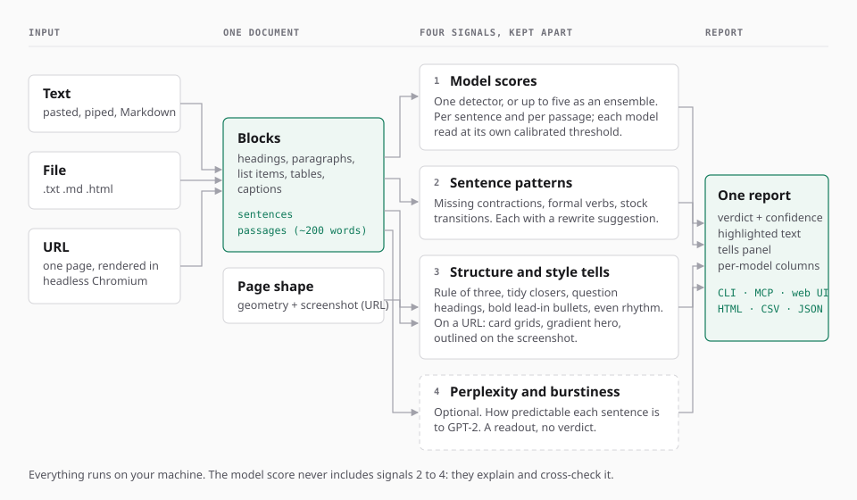
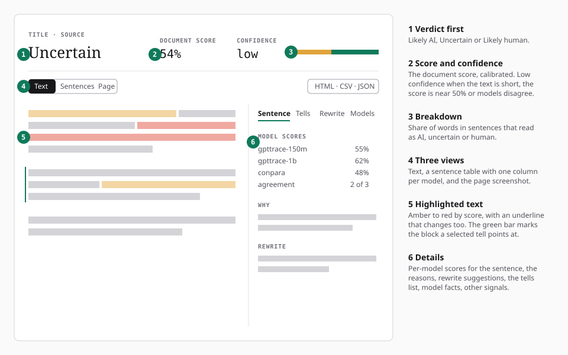

# How ai-detect works

Two original diagrams and the reasoning behind them, for whoever writes the README. Measurements are in `MODEL-EVAL-2026-11.md`; the full feature list is in `FEATURES.md`.

## One input, four signals



(`diagrams/pipeline.svg`, with a PNG copy at `diagrams/pipeline.png`.)

1. **Input.** Text, a file, or one URL. A URL is opened in headless Chromium on the user's machine so the page is read as a reader sees it.
2. **One document.** Whatever came in is parsed into blocks: headings, paragraphs, list items, tables, captions. Prose blocks are split into sentences. Consecutive sentences are also packed into passages of about 200 words.
3. **Four signals, kept apart.**
   - *Model scores.* A classifier trained to tell human from machine text scores every sentence and every passage. One model, or up to five as an ensemble.
   - *Sentence patterns.* Rules that explain a flagged sentence in plain terms (a missing contraction, a formal verb) and suggest a rewrite.
   - *Structure and style tells.* Page-level habits: everything in threes, sections that close with a summary line, bold lead-in bullets, even paragraph lengths. On a fetched page, layout shapes too, outlined on a screenshot.
   - *Perplexity and burstiness.* Optional. How predictable each sentence is to a small language model, and how much that varies.
4. **One report**, shown by the command line, the MCP server and the web UI, and exportable.

The model score never includes the other three. They explain it and cross-check it.

## How the methods relate to what detector vendors describe

GPTZero's public explainer (https://gptzero.me/news/how-ai-detectors-work, read 24 Nov 2026) describes the field in terms that map onto ai-detect as follows. The wording here is ours.

| Method the article describes | In ai-detect |
|---|---|
| Trained classifiers over learned text representations | Signal 1. Six open classifiers, selectable |
| Perplexity: how surprising the words are to a language model | Signal 4, from GPT-2, per sentence and per document |
| Burstiness: how much that varies across the document | Signal 4 (spread of per-sentence perplexity), and the sentence-length variation figure that is always shown |
| Sentence-level highlighting | Yes: every sentence is scored and shaded |
| A separate "mixed" class and a confidence statement | A confidence level and an "Uncertain" band. There is no trained mixed-authorship class: that needs a model trained for it |
| Calibration that prefers missing AI text to accusing a human | Each model is read at the point where about 5% of human text is flagged, on a small local corpus |
| Robustness to paraphrasing tools | Only as good as each open model. Not something ai-detect adds |
| Checking with more than one detector | The ensemble: several models side by side with their agreement |
| Plagiarism and source checks, writing history | Not built. Different problems |

The article says its own models are built to ignore punctuation such as em dashes. ai-detect reports an em dash as a low-severity style tell, in the separate tells list, and never feeds it to a model score.

## Reading a result



(`diagrams/result-anatomy.svg`, PNG copy alongside. Real screenshots are in `screenshots/`; `screenshots/result-ensemble-light.png` is the same screen.)

The order is deliberate: the verdict and how far to trust it come first, the evidence second.

- **Document score** is the calibrated score of the passages. It is the number to quote.
- **Confidence** drops to low when the text is under about 150 words, when the score is near 50%, or when the models disagree.
- **Sentence shading** is a rough signal. In the local evaluation the best model caught 42% of AI sentences at a 5% false-positive rate; on passages the same model caught all of them.
- **Raw and calibrated.** A model's raw percentage is what it printed. Its calibrated value is that same score re-read so 50% means "about 5% of human text scores this high". The two can differ a great deal: one model's raw 99.9% sits at its calibrated 50%.

## Why an ensemble, and what it does not do

Each model has blind spots, and they are not the same ones. Run together they show where they agree. In the evaluation no combination was more accurate than the best single model. The ensemble's value is that disagreement is visible: on the worked example one model alone said "Likely AI" and five together said "Uncertain".

## Where the work happens

```
MCP client  --stdio-->  ai-detect-mcp  --HTTP on 127.0.0.1-->  engine (ai-detect serve)
                                                               |  models, downloads, history
browser  ------------------------------------------------------+  the web UI
ai-detect (CLI)  runs the same analysis code in its own process
```

The MCP server holds no models. It starts the engine, or finds one already running, and forwards requests. That keeps the MCP handshake instant, lets the dashboard show what an MCP call is doing, and avoids a Windows problem where loading compiled modules stalls in a process that is reading standard input.
